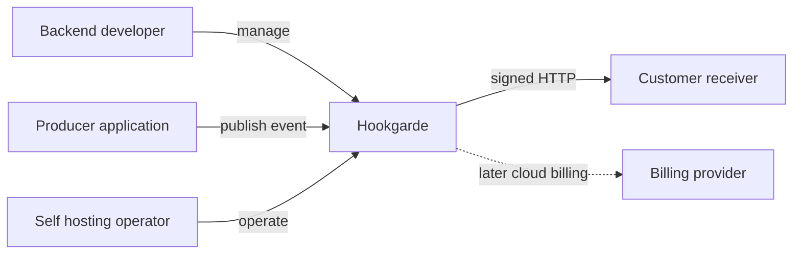
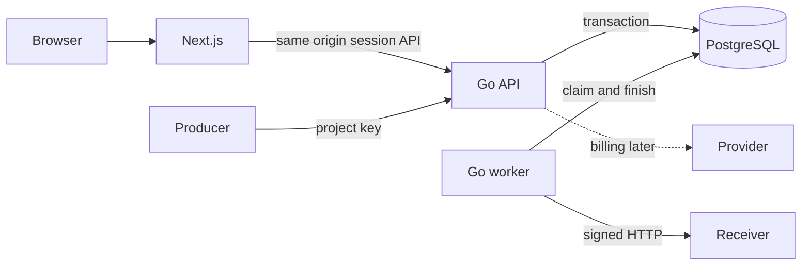
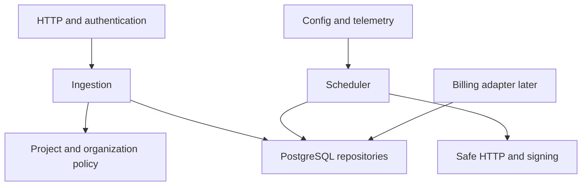
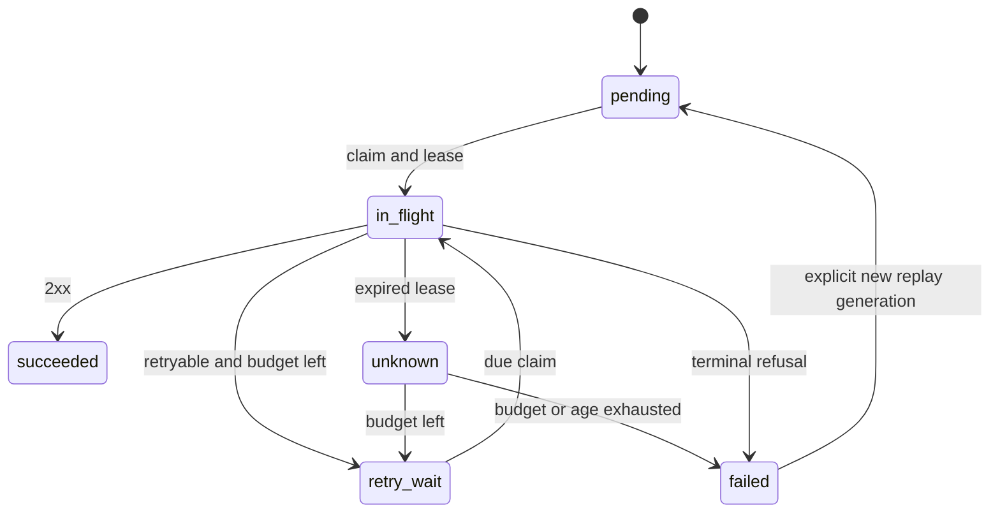
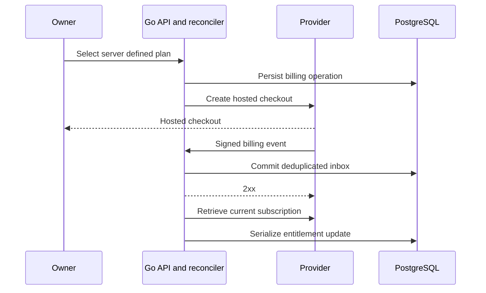
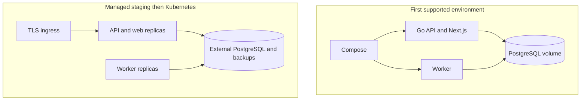
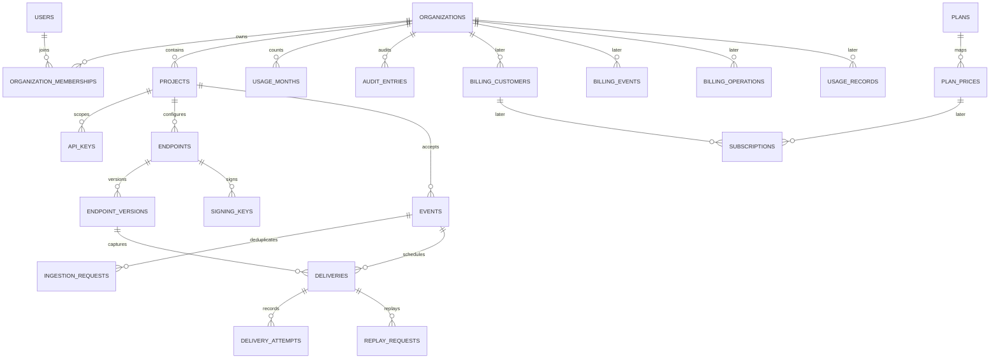

# Hookgarde PRD 2.0

Product and Engineering Planning Package

Version 2.0 | 10 October 2026

This Markdown edition contains the finalized PRD, supporting engineering specifications and dedicated-chat handover. The product requirements chapter is authoritative. Architecture diagrams are embedded as editable Mermaid code.

[Initial OpenAPI specification](sources/openapi.yaml)

## Contents
1. [Product Requirements Document 2.0](#chapter-01)
2. [System Architecture and Design](#chapter-02)
3. [PostgreSQL Database Design](#chapter-03)
4. [API Specification](#chapter-04)
5. [Agile Product Backlog](#chapter-05)
6. [Sprint Roadmap](#chapter-06)
7. [Engineering Learning Roadmap](#chapter-07)
8. [Security and Reliability Requirements](#chapter-08)
9. [Open Core Licensing and Billing Strategy](#chapter-09)
10. [Build in Public Strategy](#chapter-10)
11. [Architecture Decision Register](#chapter-11)
12. [Sprint 0 Implementation Plan](#chapter-12)
13. [Engineering Chat Handover](#chapter-13)

<a id="chapter-01"></a>

## Hookgarde Product Requirements Document 2 0

Version 2.0 | 10 October 2026 | Authoritative product requirements

Hookgarde will provide an independently usable self-hosted webhook delivery core, followed by a managed cloud service. The first release must demonstrate durable event acceptance, secure asynchronous delivery and inspectable recovery. This PRD controls scope and behavior; supporting specifications explain how to implement it. No application implementation or external publication is part of this planning package.

Brand tagline: Reliable webhooks. Zero infrastructure headaches.

The tagline describes the managed service aspiration. OSS operators still own infrastructure, backups and monitoring; delivery has finite retries and can fail. Never interpret the tagline as a reliability guarantee.

#### Decision status and terminology

Approved by the owner: Hookgarde name; existing hookgarde GitHub repository and Hookgarde X account as reported by the owner; open-core intent; Go, PostgreSQL, Next.js/TypeScript monorepo; Docker Compose; GitHub Actions; one-week sprints; backend implemented by the learner; billing deferred; Bachs preferred candidate and Stripe alternative; Kubernetes later.

Adopted planning baseline: the technical contracts below preserve valid earlier decisions. Detailed defaults and recommended refinements remain reviewable architecture choices, not claims of deployed behavior. Assumptions are marked H1-H3 or validation targets. Open decisions include OSS license, proprietary feature boundary, pricing, provider production eligibility and hosting budget.

Organization is the tenant boundary. The prior PRD used tenant; organization_id now names the same concept consistently. MVP has one owner membership and one organization per provisioned owner. Future team invitations and additional roles are not MVP. API project paths remain unchanged; organization membership is inferred from authenticated scope, never trusted from a submitted organization_id.

#### Review findings and resolved gaps

| Prior gap | Resolution in this baseline |
| --- | --- |
| Name and provider direction outdated | Hookgarde confirmed; Bachs evaluated with Stripe alternative |
| Billing and teams risk expanding MVP | Both remain later; complete logical design is separated from initial migrations |
| Schema only listed entities | Supporting database specification defines columns, keys, constraints and indexes |
| Route list was not a machine-readable contract | Initial OpenAPI 3.0.3 file plus operation catalog supplied |
| Fixed retry schedule described without exponential policy | Preserve six-attempt budget; recommend exponential base with explicit values below |
| Lease recovery at final attempt unclear | Recovery marks unknown and terminal exhaustion visibly; never silently drops a job |
| Retention and idempotency could diverge | Keep event metadata and request tombstones 90 days; active data retained regardless |
| No actionable backpressure behavior | Transactional queue/storage limits reject before acceptance; per-process limits are explicit |
| Success count confused with receiver processing | 2xx records transport acceptance only; receiver dedupe remains required |
| Missing diagram and learning/public-sharing plans | Separate supporting chapters with editable diagram sources and weekly goals |

### Vision and customer problem

**Small SaaS teams need to notify customers' HTTP endpoints without losing accepted events when destinations fail or workers restart, and need evidence to diagnose and replay failed deliveries.** Building that capability themselves consumes time across persistence, retries, duplicate handling, signing, security and operations.

The initial customer is a backend developer at a small SaaS company already sending outbound customer webhooks. Their painful moment is a customer reporting a missing notification while the developer cannot establish whether it was sent, failed, or processed. The economic buyer is the engineering lead responsible for reliability and engineering time.

Example: a SaaS application publishes `order.paid`. The platform commits the event and destination jobs, then sends signed HTTP requests asynchronously. A destination returning 503 is retried; the dashboard exposes attempts and permits replay after recovery. The platform does not perform the payment or guarantee the receiver's business effect.

Value proposition: **Publish an event through one API; get durable acceptance, bounded retries, verifiable delivery and an inspectable failure trail.** This is outbound webhook infrastructure, not a general event bus, inbound webhook gateway or payment gateway.

#### Personas and jobs to be done

| Persona | Job to be done | Observable outcome |
| --- | --- | --- |
| Integrating backend developer | When adding customer notifications, publish reliably without constructing a delivery subsystem | Integrates API, receives a signed event and verifies it |
| On-call developer / engineering lead | When a customer reports missing events, locate the delivery, explain failure and safely replay | Finds attempt evidence and completes a replay without losing history |
| Self-hosting operator | When deployment/data control matters, run and recover the service independently | Compose installation works without a cloud account or billing provider |
| Managed cloud buyer, later | When infrastructure upkeep is costly, delegate operation while keeping the same delivery contract | Can evaluate hosted operation, limits and service terms |

#### Positioning: hypotheses to validate

Hypothesis H1: small Go-oriented SaaS teams value a straightforward self-hosted setup and explicit failure semantics. H2: inspectable recovery is a stronger initial value than a large integration catalog. H3: some teams will pay for managed operation rather than operate the core themselves.

Potential alternatives are in-house workers, managed webhook services, and general queue infrastructure. No named competitor feature, price, performance or superiority comparison is asserted here. A future comparison must record dated primary-source evidence and actual user needs. Open source and Go alone do not establish differentiation.

#### Validation and success criteria

Before expanding scope, conduct five problem interviews with developers who actually operate outbound webhooks. Ask for the most recent failure, current retry/history behavior, engineering effort, data/control constraints, adoption blockers and willingness to run or pay for a service. Do not lead with a feature pitch.

Initial discovery gate: at least three describe concrete recurring pain and two agree to test a prototype; these are provisional thresholds, not market proof. Usability gate: three testers independently create an endpoint/key, publish, inspect failure and replay with the documentation; target first successful delivery within 15 minutes of a running installation. Record failures and revise the plan if the thesis is weak.

Engineering success is demonstrated persistence, crash recovery, organization isolation and reproducible deployment. Track acceptance latency, queue age, delivery outcomes and time to diagnose. Report transport acceptance separately from receiver processing and do not claim 100% delivery.

### Scope and product model

#### MVP: self-hosted core alpha

- One owner per organization; multiple isolated organizations, projects and HTTPS endpoints. Account creation starts as operator-controlled provisioning, with login/logout and opaque sessions. Public signup, email verification and password recovery are later launch gates.
- Project and endpoint management, endpoint pause/resume, project-scoped ingestion keys and key revocation.
- Explicit destination selection; atomic durable ingestion, idempotency, asynchronous signed delivery, bounded retry, crash recovery and manual replay.
- Event list/detail, destination status, attempt timeline and sanitized error history in a Next.js dashboard.
- Configured resource/rate limits, retention, audit trail, health, basic metrics, migrations, Docker Compose, documentation and GitHub Actions.

#### Out of MVP

billing provider, subscriptions, commercial pricing, public cloud onboarding, team invitations/RBAC, SSO, arbitrary custom headers, event routing rules, SDK/library extraction, Redis/broker, strict ordering, exactly-once delivery, multi-region replication, Kubernetes and advanced analytics. Kubernetes is an eventual operational milestone after staging is proven. No technology is added merely to demonstrate it.

#### Open-core and cloud boundary

The intended open-source self-hosted core includes delivery, API, usable dashboard, signatures, security, retry/replay, history, deployment instructions and tests. Core reliability and security cannot depend on a paid entitlement or internet license check.

Managed cloud differentiates through operated hosting, upgrades, backups, monitoring and support. Potential commercial extensions—team controls, longer managed retention or organizational administration—are hypotheses; their proprietary boundary is pending. A hosted service alone is not sufficient to define which code is proprietary. Record that boundary and license before publication. Do not select Apache, MIT, copyleft or a source-available license by assumption, and do not describe a source-available license as open source without checking its status.

#### Later billing milestone

A selected provider will bill subscriptions to this platform only. Hosted Checkout and customer portal avoid handling card data. Start in test mode after the self-hosted alpha; prices and tiers remain TBD. Quotas count accepted events, not retries; final billing meters require an ADR. Verify provider signatures on raw bodies, commit a deduplicated inbox before acknowledging and reconcile authoritative subscription state despite duplicate/out-of-order events. Redirects never grant entitlements. An outage must not block accepted delivery jobs or self-hosted operation. Cancellation, grace periods, downgrade policy and live launch terms require explicit decisions before live billing.

#### Functional requirement IDs

| ID | Requirement | Acceptance evidence |
| --- | --- | --- |
| FR01 | Isolated authenticated account/project/endpoint/key management | Cross-organization and scope tests; complete owner journey |
| FR02 | Atomic acceptance and idempotency | Concurrent duplicate test and forced transaction rollback |
| FR03 | Durable asynchronous delivery and crash recovery | Worker restart and stale lease tests |
| FR04 | Retry/backoff, signing and SSRF defense | Deterministic policy, signature and network safety tests |
| FR05 | History, pause/resume and replay | Dashboard failure-to-recovery demonstration |
| FR06 | Operable self-hosted core | Fresh Compose setup, cleanup and backup restore |
| FR07, later | Independent cloud subscription module | Test-mode provider dedupe/reconciliation and outage tests |

The user implements the Go backend themselves and owns frontend work, using assistance as needed. Coaching follows Learn → Build → Test → Break → Debug → Refactor → Ship, one bounded task at a time. Review correctness, idioms, syntax, data flow and reasoning before assigning the next task. Do not generate full backend implementations unless requested.

#### Configuration behavior

Capture immutable destination URL versions at acceptance. URL edits affect future events; each old destination is revalidated before any send. Pause rejects new events targeting that endpoint and blocks new claims, but cannot recall an in-flight request. Resume releases pending work. Archive rejects ingestion and cancels unstarted jobs with an audit reason. These changes and job claims must coordinate transactionally so a pause cannot race into an unrecorded new claim. Requests targeting any ineligible endpoint fail atomically.

MVP defaults: 5 projects/organization, 10 active endpoints/organization, 10 targets/event, 256 KiB request body, 10,000 accepted events/organization/UTC month; operator-configurable, not pricing tiers. Resolve idempotent repeats before resource/quota checks. Reserve usage in the ingestion transaction; rollback consumes nothing. Existing accepted jobs survive quota exhaustion or limit reductions.
#### Primary user journeys

Integration: operator provisions owner -> owner logs in -> creates project and endpoint -> copies signing secret and ingestion key once -> producer sends byte-stable event with Idempotency-Key -> 202 returns committed IDs -> receiver verifies signature and durably deduplicates -> dashboard shows destination acceptance.

Incident recovery: owner filters terminal failures -> opens sanitized attempt evidence -> repairs receiver -> replays with a stable idempotency key -> new generation is tracked alongside old history. Pause/resume controls future claims; it cannot retract requests already sent.

Self-hosting: clone licensed release -> configure secrets and limits -> start Compose -> apply migrations explicitly -> run smoke workflow -> operate backups/alerts -> rehearse restore before external use. No billing credentials or cloud license check is required.

Managed cloud later: verified owner onboards -> selects server-defined plan -> hosted checkout -> verified provider event committed -> reconciliation updates entitlement -> owner uses portal. Return redirect never grants paid access.

#### Authoritative delivery contract

FR02: 202 means exact event envelope, destination snapshots, delivery jobs, ingestion dedupe record and usage committed together in PostgreSQL. A DB error returns 503; a lost response after commit is recovered by retrying the same key/body. The producer's own business transaction is outside this guarantee; integration docs must explain its transactional outbox responsibility.

FR03: delivery attempts use at-least-once semantics, finite retry and no ordering guarantee. Receiver acceptance followed by worker crash may cause duplicates. Terminal failed/canceled/expired jobs remain visible; a receiver that never recovers may never accept. This is not eventual successful delivery for every event or exactly-once business processing.

FR04: preserve six total attempts and a 24-hour generation deadline. Recommended v2 refinement: after failed attempt n (n=1..5), base_delay = min(10 seconds * 4^(n-1), 2 hours), plus uniform 0-20% positive jitter. Bases are 10, 40, 160, 640 and 2560 seconds. This replaces the older 10s/1m/5m/30m/2h table deliberately; an ADR records the change. Retry-After on 429/503 is a minimum, capped at six hours; the 24-hour deadline still wins. Retry transport errors/timeouts, 408, 429 and 5xx. Other 4xx and 3xx terminate; no redirects; any 2xx records receiver transport acceptance. New replay resets budget/deadline, keeps original event bytes and URL version, and preserves prior history.

FR05: event summaries are pending (active jobs exist), completed (all succeeded), or completed_with_failures (all terminal and some failed/canceled). A delivery state is pending, in_flight, retry_wait, succeeded, failed or canceled. A paused endpoint is shown separately from job state. Attempts distinguish started, succeeded, failed and unknown.

#### Nonfunctional targets

| ID | Requirement | Evidence |
| --- | --- | --- |
| NFR01 | No accepted job exists only in memory; durable PostgreSQL commit required | Forced rollback, process restart and worker crash tests |
| NFR02 | Bound request size 256 KiB; outbound request 10s; 10 active sends/process | Oversize/slow receiver tests and resource report |
| NFR03 | Initial benchmark: 10 events/s, five targets/event, 10k backlog, 2 vCPU/4 GiB recorded host | Load result; local quota override recorded; no commercial SLA |
| NFR04 | Ingestion p95 <300ms; first start p95 <5s without backlog/under provisioned capacity | Separate acceptance/worker latency measurements |
| NFR05 | TLS, organization isolation, hashed tokens, SSRF defense and redaction mandatory | Security regression suite |
| NFR06 | Fresh install, compatible migrations and restore rehearsed | Compose smoke plus timed recovery |
| NFR07 | Provisional staging RPO <=24h, RTO <=4h; later availability goal 99.5% monthly | Daily backup and restore exercise; separate SLA decision |
| NFR08 | Dashboard has keyboard access, labels and textual statuses | Manual accessibility journey |

#### Backpressure and fairness

Recommended initial local queue cap: 100,000 nonterminal jobs globally and 10,000 per organization; storage soft limit and disk reserve are operator configuration. Atomically reserve queue slots for all destinations during ingestion, alongside usage, and release on terminal transition. Reject 503 queue_capacity_exceeded with Retry-After before accepting when capacity/storage safety thresholds are reached; do not consume quota or create partial jobs. Paused jobs count toward capacity. Replays reserve slots too; every release is guarded by state transition/token to avoid double decrement. A reconciliation check repairs counter drift. Limits are benchmarked before being treated as capacity claims.

Use bounded polling batches and oldest-due ordering with fair organization selection; configure a per-endpoint cap (initial recommendation: 2/process). Local caps are not global guarantees across replicas; reserve cluster-wide permits only if validated requirements demand them. Prevent one endpoint consuming all worker capacity. DB outage stops claims; recovery resumes durable jobs. Adding API replicas does not increase a fixed shared quota, and adding workers does not imply unlimited outbound capacity.

#### Product roadmap and unresolved decisions

Deliver the safe self-hosted alpha first, validate it with real developers, then operate managed staging before commercial billing. Cloud prices, metering/overages, support commitments and live provider eligibility are pending. The release and sprint documents define gates; dates depend on weekly learning capacity. Do not claim market fit, competitor superiority or current feature completion.

Before external launch resolve license/boundary, signup/recovery, data terms, abuse response, endpoint ownership verification if public signup permits arbitrary targets, deployment budget and support ownership. Before live billing resolve provider/KYC, pricing/refunds/taxes and lifecycle/entitlement rules. Hookgarde's name is owner-selected; this package makes no trademark clearance claim.

<a id="chapter-02"></a>

## Hookgarde System Architecture and Design

Hookgarde starts as a modular monolith with independently runnable API and worker processes sharing one Go module. The split lets HTTP serving and outbound scheduling scale and shut down independently without requiring separate domain services. PostgreSQL is the durable source of truth; Next.js presents the operator interface.

### Architecture decisions and tradeoffs

The API commits jobs directly in its event transaction. A separate outbox inside Hookgarde would duplicate queue state while PostgreSQL already provides atomicity. A broker becomes useful only with demonstrated DB contention, routing or throughput requirements; a future broker would require an outbox/relay to preserve durable acceptance.

Use net/http, context, database/sql and parameterized SQL initially, with a supported PostgreSQL driver selected and pinned at scaffolding. Keep use cases explicit and interfaces small where alternate adapters/testing need them. Handlers parse/authenticate/respond; services own invariants; repositories own SQL; the outbound client owns network policy. Avoid a package per trivial function or a generic abstraction framework.

Worker claim transaction: check project/endpoint eligibility, lock due jobs with FOR UPDATE SKIP LOCKED, create a started attempt, increment reserved attempt count and set lease/token. Commit before I/O. Outcome transaction checks token and state, writes attempt outcome and schedules retry or terminal transition. Use consistent project -> endpoint -> job lock order for ingestion/pause/archive/replay/claim; recheck after acquiring eligibility locks to resolve races. Batch sizes and isolation choices require real concurrency tests.

Lease = 60s, request deadline = 10s, connect/TLS = 3s, response headers = 5s; total deadline wins. Read at most 16 KiB and store only a sanitized 4 KiB preview. A 2xx is successful on receipt of headers; preview read failure must not turn an observed 2xx into a failure. Normal shutdown stops claims, drains up to 15s then cancels; expiry recovers interrupted work. A claim consumes attempt budget because network side effects may be uncertain.

Recovery: mark expired started attempt unknown and fence its token. If budget/deadline exhausted, fail visibly; otherwise persist retry eligibility. Claims may exhaust without any confirmed remote request after repeated crashes: report that fact accurately. Lease tokens cannot stop a stale process from causing an external duplicate; they prevent corrupt DB completion. Disable transport behaviors that silently add POST retries outside the tracked attempt policy.

### Repository layout

```text
hookgarde/
  apps/api/
    go.mod
    cmd/api/       # HTTP process
    cmd/worker/    # delivery and later billing reconciliation
    cmd/admin/     # local operator provisioning when needed
    internal/
      httpapi/ auth/ organization/ project/
      ingestion/ delivery/ postgres/ config/ telemetry/
      billing/     # add only in billing milestone
    migrations/    # incremental reviewed SQL
  apps/web/        # Next.js and TypeScript
  docs/
    prd.md  api/openapi.yaml  adr/  runbooks/  diagrams/
  deploy/docker/   # container definitions
  deploy/kubernetes/ # later only
  tests/integration/
  .github/workflows/
  compose.yaml  .env.example  README.md  CONTRIBUTING.md
  LICENSE          # after owner selection
```

Pin supported Go, Node, Next.js and PostgreSQL versions during Sprint 0; no unverified latest-version claim is embedded here. Docker Compose is the first supported environment. Module import path uses the actual repository owner; do not invent it.

### Architecture diagrams

The following figures are planning designs, not deployed topology. Editable Mermaid sources accompany this package. Billing and Kubernetes figures depict later milestones.

#### System context



The developer integrates; the owner investigates failures; the operator runs the self-hosted installation. Receiving applications own deduplication and business processing.

#### Container architecture



API and worker are processes from one application. No network call to a payment provider participates in an event acceptance or delivery transaction.

#### Component architecture



Domain packages own rules; adapters own SQL and network I/O. Dependency injection is introduced at actual test boundaries rather than wrapping every standard-library call.

#### Event ingestion sequence

```mermaid
sequenceDiagram
 participant P as Producer
 participant A as Go API
 participant D as PostgreSQL
 P->>A: POST event, Idempotency-Key
 A->>D: BEGIN; dedupe and validate scope
 A->>D: event + snapshots + jobs + usage + queue slots
 D-->>A: COMMIT
 A-->>P: 202 accepted
 Note over P,D: If response lost, retry identical key/body
```

All selected destinations commit together. A uniqueness race waits/rechecks the winning transaction; a loser never consumes an additional event allowance.

#### Webhook delivery sequence

```mermaid
sequenceDiagram
 participant W as Worker
 participant D as PostgreSQL
 participant R as Receiver
 W->>D: Claim with lease and attempt; commit
 W->>R: Validated IP, signed POST, bounded deadline
 R-->>W: 2xx or failure
 W->>D: Outcome guarded by lease token
 Note over W,R: Crash after acceptance can duplicate delivery
```

No row lock is held while waiting for the receiver. Outcome storage is fenced; external side effects still require receiver idempotency.

#### Retry and failure recovery



Persisted schedules survive restart. Unknown is an attempt outcome; the diagram shows recovery conceptually, not an additional delivery state.

#### Billing integration sequence



Later milestone. Redirect alone grants nothing. Persist uncertainty and reconcile before retrying a provider write; never assume all adapters have identical idempotency guarantees.

#### Deployment architecture



Start with Compose; staging uses TLS, private DB, secret injection, backups and egress restrictions. Kubernetes adds probes, resources and controlled rollout only later; it does not provide application durability.

<a id="chapter-03"></a>

## Hookgarde PostgreSQL Database Design

This is the complete logical design. It does not authorize implementing every table now. Sprint 0 requires no domain schema: only optional migration-tool bookkeeping and a disposable DB connectivity check. Introduce account/project tables in Sprint 1, ingestion/queue tables in Sprints 2-4, and billing tables only in the later billing milestone.

### Schema conventions and isolation

All listed fields are NOT NULL unless marked nullable. UUIDs are application-generated opaque identities; timestamptz values are UTC. Each PK has its primary index. Named organization-scoped IDs include composite unique parent keys so child FKs can enforce matching organization and project. Use RESTRICT for durable resource deletion; retention explicitly purges safe payload/evidence, not pending jobs through cascading deletes. Operational timestamps are written by the service/database clock consistently. Optional updated_at is added only where a real query or optimistic control needs it.

Users are global identities; memberships authorize organizations. Every project-owned row stores organization_id and project_id. Queries always predicate organization/project scope; cross-scope resource IDs return 404. PostgreSQL row-level security is a potential later defense, not assumed present. No connection-scoped organization state may leak between pooled requests.

Composite notation uses org as shorthand for organization_id only in explanations. Foreign keys must include full keys as described; globally unique UUIDs alone do not enforce tenant relationships.

### Relationships



The figure highlights domain relationships; session, dedupe, audit and policy auxiliary tables are detailed below. Later commercial entities are labeled separately. Editable Mermaid ER source is included.

#### organizations

Phase: MVP. Purpose: Tenant, resource policy and lifecycle boundary.

| Column | PostgreSQL type | Constraint or meaning |
| --- | --- | --- |
| id | uuid | PK |
| name | varchar(120) | not null |
| deployment_mode | text | self_hosted or cloud |
| limits | jsonb | validated resource/rate settings |
| active_jobs | bigint | not null default 0; >=0 |
| created_at | timestamptz | not null |
| archived_at | timestamptz | nullable |

Keys and indexes: Lock organization when changing resources/quota/active_jobs. Index created_at,id. No billing credentials stored here.

#### users

Phase: MVP. Purpose: Identity separate from organization access.

| Column | PostgreSQL type | Constraint or meaning |
| --- | --- | --- |
| id | uuid | PK |
| email | text | normalized, unique |
| password_hash | text | Argon2id encoded hash |
| created_at | timestamptz | not null |
| disabled_at | timestamptz | nullable |

Keys and indexes: Unique normalized email; provisioner creates user, organization and owner membership atomically. No plaintext password storage.

#### organization_memberships

Phase: MVP owner only. Purpose: Explicit authorization association; invitations and extra roles later.

| Column | PostgreSQL type | Constraint or meaning |
| --- | --- | --- |
| organization_id | uuid | FK organizations |
| user_id | uuid | FK users |
| role | text | owner only in MVP |
| created_at | timestamptz | not null |

Keys and indexes: PK (organization_id,user_id). MVP unique user_id and partial unique organization_id WHERE role=owner enforce one organization/user and one owner. Later migrations remove owner-only limits deliberately; prevent loss of final owner.

#### sessions

Phase: MVP. Purpose: Revocable opaque browser sessions.

| Column | PostgreSQL type | Constraint or meaning |
| --- | --- | --- |
| id | uuid | PK |
| organization_id | uuid | FK owner membership via org,user |
| user_id | uuid | FK users |
| token_hash | bytea | unique; 32-byte SHA256 digest |
| csrf_hash | bytea | 32-byte random token digest |
| created_at | timestamptz | not null |
| expires_at | timestamptz | created +24h |
| revoked_at | timestamptz | nullable |

Keys and indexes: FK (organization_id,user_id) membership; expires_at>created_at. Index expires_at, user_id. Token lookup is unique; constant-time secret comparison where needed.

#### projects

Phase: MVP. Purpose: Scope for producer keys, endpoints and events.

| Column | PostgreSQL type | Constraint or meaning |
| --- | --- | --- |
| id | uuid | PK |
| organization_id | uuid | FK organizations |
| name | varchar(120) | not null, trimmed nonempty |
| created_at | timestamptz | not null |
| archived_at | timestamptz | nullable |

Keys and indexes: Unique (organization_id,id); list index (organization_id,created_at,id). Resource count changes serialized with organization policy.

#### api_keys

Phase: MVP. Purpose: Project ingestion-only credentials.

| Column | PostgreSQL type | Constraint or meaning |
| --- | --- | --- |
| id | uuid | PK |
| organization_id | uuid | scope |
| project_id | uuid | composite FK projects |
| name | varchar(120) | not null |
| prefix | text | display identifier only |
| token_hash | bytea | unique 32-byte digest |
| scope | text | events:write only in MVP |
| created_at | timestamptz | not null |
| expires_at | timestamptz | nullable |
| revoked_at | timestamptz | nullable |

Keys and indexes: FK (organization_id,project_id) projects; index (organization_id,project_id,created_at,id). Random 32-byte token revealed once; no dashboard scope.

#### endpoints

Phase: MVP. Purpose: Destination identity and pause status.

| Column | PostgreSQL type | Constraint or meaning |
| --- | --- | --- |
| id | uuid | PK |
| organization_id | uuid | scope |
| project_id | uuid | composite FK projects |
| description | varchar(500) | not null default empty |
| paused | boolean | not null default false |
| current_version_id | uuid | scoped FK endpoint_versions |
| created_at | timestamptz | not null |

Keys and indexes: Unique (organization_id,project_id,id). Current-version FK includes endpoint identity and is nullable only within initial insert transaction; deferred consistency check requires version on commit. List index org,project,created_at,id. No physical delete of active accepted work.

#### endpoint_versions

Phase: MVP. Purpose: Immutable URLs captured by delivery generations.

| Column | PostgreSQL type | Constraint or meaning |
| --- | --- | --- |
| id | uuid | PK |
| organization_id | uuid | scope |
| project_id | uuid | scope |
| endpoint_id | uuid | scoped FK endpoints |
| version | integer | >0 |
| url | text | validated HTTPS URL |
| created_at | timestamptz | not null |

Keys and indexes: Unique (organization_id,project_id,endpoint_id,id), and (endpoint_id,version). FK (org,project,endpoint) endpoints. URL length <=2048 recommendation; cannot mutate an accepted URL snapshot.

#### signing_keys

Phase: MVP. Purpose: Versioned encrypted endpoint secrets.

| Column | PostgreSQL type | Constraint or meaning |
| --- | --- | --- |
| id | uuid | PK |
| organization_id | uuid | scope |
| project_id | uuid | scope |
| endpoint_id | uuid | scoped FK endpoints |
| version | integer | >0; unique endpoint,version |
| ciphertext | bytea | AEAD nonce and encrypted secret |
| encryption_key_id | text | external key version |
| activates_at | timestamptz | not null |
| retires_at | timestamptz | nullable |
| revoked_at | timestamptz | nullable |
| created_at | timestamptz | not null |

Keys and indexes: Unique scoped identity and endpoint/version; retired>activation. Serialize rotations on endpoint lock. Index endpoint_id,activates_at. Rotation policy determines active signing key; attempts reference the actual key.

#### events

Phase: MVP. Purpose: Immutable accepted envelope with retained metadata.

| Column | PostgreSQL type | Constraint or meaning |
| --- | --- | --- |
| id | uuid | PK |
| organization_id | uuid | scope |
| project_id | uuid | scoped FK projects |
| type | varchar(128) | not null nonempty |
| envelope_bytes | bytea | exact wire bytes; nullable after purge |
| payload_size | integer | >=0; accepted limit validated |
| occurred_at | timestamptz | producer time |
| accepted_at | timestamptz | server commit context |
| retention_at | timestamptz | nullable until final generation terminal |
| payload_purged_at | timestamptz | nullable |

Keys and indexes: Unique (organization_id,project_id,id). Index org,project,accepted_at DESC,id DESC; optionally org,project,type,accepted_at,id after measured need. Keep metadata/tombstones through dedupe horizon; active generations prevent body purge.

#### ingestion_requests

Phase: MVP. Purpose: Concurrent publication deduplication and response recovery.

| Column | PostgreSQL type | Constraint or meaning |
| --- | --- | --- |
| id | uuid | PK |
| organization_id | uuid | scope |
| project_id | uuid | FK projects |
| key | varchar(128) | 1-128 printable ASCII bytes |
| request_hash | bytea | 32-byte SHA256 of exact request |
| event_id | uuid | scoped FK events |
| acceptance_response | jsonb | original IDs and accepted timestamp |
| created_at | timestamptz | not null |
| expires_at | timestamptz | >=created +90d |

Keys and indexes: Unique (project_id,key); FK org,project,event events. Expiry index expires_at. Concurrent unique conflict must resolve winner; do not compare uncommitted rows as absent.

#### deliveries

Phase: MVP. Purpose: Durable queue and replay generations.

| Column | PostgreSQL type | Constraint or meaning |
| --- | --- | --- |
| id | uuid | PK |
| organization_id | uuid | scope |
| project_id | uuid | scope |
| event_id | uuid | scoped FK events |
| endpoint_id | uuid | scoped FK endpoints |
| endpoint_version_id | uuid | same endpoint FK version |
| generation | integer | >0 |
| state | text | six PRD delivery states |
| attempts_count | integer | 0..6 |
| next_attempt_at | timestamptz | due time; nullable when terminal |
| lease_token | uuid | in-flight only |
| lease_until | timestamptz | in-flight only |
| deadline_at | timestamptz | generation created +24h |
| last_error | text | sanitized bounded classification |
| created_at | timestamptz | not null |
| terminal_at | timestamptz | terminal only |

Keys and indexes: Unique scoped ID and (event_id,endpoint_id,generation). Partial unique (event_id,endpoint_id) WHERE state IN (pending,in_flight,retry_wait). Due index (next_attempt_at,id) on pending/retry_wait; expiry index lease_until on in_flight. CHECK lease pair exactly when in_flight, terminal_at exactly when terminal. Scope FKs include event/project and version/endpoint relationships.

#### delivery_attempts

Phase: MVP. Purpose: Immutable evidence for each reserved send.

| Column | PostgreSQL type | Constraint or meaning |
| --- | --- | --- |
| id | uuid | PK and outbound attempt ID |
| organization_id | uuid | scope |
| project_id | uuid | scope |
| delivery_id | uuid | scoped FK deliveries |
| sequence | integer | 1..6 |
| lease_token | uuid | claim token for evidence |
| signing_key_id | uuid | scoped FK signing_keys; nullable before send |
| started_at | timestamptz | not null |
| ended_at | timestamptz | nullable while started |
| outcome | text | started/succeeded/failed/unknown |
| http_status | smallint | nullable; 100..599 |
| duration_ms | integer | nullable >=0 |
| error_class | varchar(120) | nullable |
| response_preview | text | sanitized <=4096 bytes |

Keys and indexes: Unique (delivery_id,sequence), scoped parent FK and key-endpoint consistency checked in outcome transaction. Index delivery_id,sequence. Append evidence once; stale workers cannot revise an unknown attempt after fencing.

#### replay_requests

Phase: MVP. Purpose: Idempotent manual replay.

| Column | PostgreSQL type | Constraint or meaning |
| --- | --- | --- |
| id | uuid | PK |
| organization_id | uuid | scope |
| project_id | uuid | scope |
| original_delivery_id | uuid | scoped FK deliveries |
| key | varchar(128) | printable ASCII 1..128 |
| request_hash | bytea | 32-byte fingerprint |
| new_delivery_id | uuid | scoped FK deliveries |
| created_at | timestamptz | not null |
| expires_at | timestamptz | >=created +90d |

Keys and indexes: Unique (organization_id,original_delivery_id,key); both delivery FKs retain organization/project. Replay tombstones outlive payloads; index expires_at.

#### usage_months

Phase: MVP. Purpose: Transactional UTC monthly accepted-event quota.

| Column | PostgreSQL type | Constraint or meaning |
| --- | --- | --- |
| organization_id | uuid | FK organizations |
| month_start | date | first UTC calendar day |
| accepted_event_count | bigint | >=0 default 0 |
| updated_at | timestamptz | not null |

Keys and indexes: PK (organization_id,month_start). Conditional increment within acceptance; repeats/retries/replay consume no new event allowance. This local quota period is not necessarily the future invoice period.

#### system_capacity

Phase: MVP. Purpose: Shared bounded queue slots.

| Column | PostgreSQL type | Constraint or meaning |
| --- | --- | --- |
| key | text | PK; delivery_queue |
| active_jobs | bigint | >=0 |
| capacity | bigint | >0 |
| updated_at | timestamptz | not null |

Keys and indexes: One row for global queue admission; conditional update in ingestion/replay transaction. Reconcile against actual nonterminal jobs; potential contention measured before redesign.

#### rate_limit_buckets

Phase: MVP. Purpose: Limits across API replicas.

| Column | PostgreSQL type | Constraint or meaning |
| --- | --- | --- |
| scope_hash | bytea | nonreversible keyed scope identifier |
| action | text | ingest/login/mutation/replay |
| window_start | timestamptz | fixed window boundary |
| count | integer | >=0 |
| expires_at | timestamptz | cleanup horizon |

Keys and indexes: PK (scope_hash,action,window_start); atomic conditional count. Index expires_at. Bound key cardinality for attacker-created login buckets; trust forwarded IP only from configured proxy.

#### audit_entries

Phase: MVP. Purpose: Minimal security and operator change evidence.

| Column | PostgreSQL type | Constraint or meaning |
| --- | --- | --- |
| id | uuid | PK |
| organization_id | uuid | FK organizations |
| actor_user_id | uuid | nullable FK users |
| actor_key_id | uuid | nullable FK api_keys |
| action | text | allowlisted |
| resource_type | text | allowlisted |
| resource_id | uuid | logical resource; not arbitrary SQL reference |
| request_id | text | bounded |
| occurred_at | timestamptz | not null |
| metadata | jsonb | allowlisted redacted fields |

Keys and indexes: Index (organization_id,occurred_at,id). Actor org checked by authenticated context. No payloads/secrets. Retention default 90d recommendation; future required legal retention separately reviewed.

#### plans

Phase: Later cloud. Purpose: Versioned commercial catalog.

| Column | PostgreSQL type | Constraint or meaning |
| --- | --- | --- |
| id | uuid | PK |
| code | text | plan family code |
| version | integer | >0 |
| limits | jsonb | validated cloud limits |
| active | boolean | not null |
| created_at | timestamptz | not null |

Keys and indexes: No assumed price; pricing amounts/currencies live in immutable plan_prices. Unique (code,version); code identifies the plan family and version identifies immutable policy.

#### plan_prices

Phase: Later cloud. Purpose: Provider mappings for server-approved checkout.

| Column | PostgreSQL type | Constraint or meaning |
| --- | --- | --- |
| id | uuid | PK |
| plan_id | uuid | FK plans |
| provider | text | bachs or stripe |
| environment | text | sandbox/live |
| provider_price_id | text | provider product/price identifier |
| amount_minor | bigint | >=0 fixed price when applicable |
| currency | char(3) | ISO currency |
| interval | text | month/year |
| created_at | timestamptz | not null |

Keys and indexes: Unique (provider,environment,provider_price_id); billing policy chooses applicable immutable mapping. Cannot accept price/amount from browser as authority.

#### billing_customers

Phase: Later cloud. Purpose: Provider customer mapping per organization.

| Column | PostgreSQL type | Constraint or meaning |
| --- | --- | --- |
| id | uuid | PK |
| organization_id | uuid | FK organizations |
| provider | text | selected adapter |
| environment | text | sandbox/live |
| provider_customer_id | text | not null |
| created_at | timestamptz | not null |

Keys and indexes: Unique org,provider,environment and provider,environment,provider_customer_id. Private identifiers; no card/bank details retained.

#### subscriptions

Phase: Later cloud. Purpose: Reconciled entitlement evidence.

| Column | PostgreSQL type | Constraint or meaning |
| --- | --- | --- |
| id | uuid | PK |
| organization_id | uuid | scope |
| billing_customer_id | uuid | same-org FK billing_customers |
| plan_price_id | uuid | FK plan_prices |
| provider_subscription_id | text | unique within provider/environment |
| provider | text | adapter |
| environment | text | sandbox/live |
| provider_status | text | raw supported status |
| entitlement_status | text | normalized server policy |
| period_start | timestamptz | nullable |
| period_end | timestamptz | nullable |
| cancel_at_period_end | boolean | not null |
| grace_until | timestamptz | nullable pending policy |
| verified_at | timestamptz | last authoritative retrieval |
| created_at | timestamptz | not null |

Keys and indexes: Unique provider,environment,provider_subscription_id; partial unique organization/provider/env for current relationship. Serialize reconciliation per org/provider; mapping unsupported states fails safely for new entitlements, not accepted work.

#### billing_events

Phase: Later cloud. Purpose: Verified durable inbox and dedupe tombstones.

| Column | PostgreSQL type | Constraint or meaning |
| --- | --- | --- |
| id | uuid | PK |
| provider | text | adapter |
| environment | text | sandbox/live |
| provider_event_id | text | stable verified ID |
| organization_id | uuid | nullable until trusted mapping |
| event_type | text | bounded |
| raw_payload | bytea | encrypted/minimized retention |
| received_at | timestamptz | not null |
| state | text | pending/in_flight/processed/failed |
| lease_token | uuid | nullable |
| lease_until | timestamptz | nullable |
| attempts_count | integer | >=0 |
| next_attempt_at | timestamptz | nullable |
| last_error | text | sanitized |

Keys and indexes: Unique (provider,environment,provider_event_id); partial due/lease indexes like delivery queue. Payload may be purged; dedupe ID retention decided before live billing. Organization lookup cannot trust an arbitrary payload org field.

#### billing_operations

Phase: Later cloud. Purpose: Recover uncertain provider writes.

| Column | PostgreSQL type | Constraint or meaning |
| --- | --- | --- |
| id | uuid | PK; stable operation ID |
| organization_id | uuid | FK organizations |
| provider | text | adapter |
| environment | text | sandbox/live |
| kind | text | customer/checkout/portal/refund/usage |
| idempotency_key | text | persisted before network call |
| request_hash | bytea | 32-byte digest |
| provider_resource_id | text | nullable while uncertain |
| state | text | pending/uncertain/succeeded/failed |
| created_at | timestamptz | not null |
| updated_at | timestamptz | not null |

Keys and indexes: Unique org,provider,environment,kind,key. Do not regenerate a key after timeout; reconcile with provider-specific semantics. Index state,updated_at for recovery.

#### usage_records

Phase: Later metering. Purpose: Immutable billable units if validated pricing requires them.

| Column | PostgreSQL type | Constraint or meaning |
| --- | --- | --- |
| id | uuid | PK |
| organization_id | uuid | FK organizations |
| event_id | uuid | nullable scoped FK events |
| meter | text | accepted_event initially recommended |
| quantity | bigint | >0 |
| occurred_at | timestamptz | not null |
| provider_operation_id | uuid | nullable FK billing_operations |
| export_state | text | pending/exported/failed |

Keys and indexes: Unique org,meter,event_id for nonnull event; events recorded only once. Separate invoice-period aggregation from UTC quota. No chargeable replay unless explicitly agreed. Retain independently of body purge.

### Transaction boundaries and concurrency

Provision owner/user/organization/membership together. Endpoint creation includes initial URL version and signing key; circular current_version reference is deferrable with consistent commit validation. Ingestion locks shared capacity, organization policy, project and endpoints in a documented order, resolves idempotency and then inserts event/jobs/dedupe/usage/slot reservation atomically. Never deliver inside acceptance.

Replay uses the same admission ordering, validates retained event and original URL, inserts new generation plus replay request, and reserves capacity atomically. Pause/archive and claims coordinate through the same policy lock order. Worker outcome transitions use lease token, update attempt/job, and release queue counters only on first terminal transition. Do not read quota then increment outside a transaction. Add DB uniqueness and checks rather than relying solely on API validation.

Lock ordering refinement: all admission paths take global capacity -> organization -> project -> endpoints in sorted ID order -> jobs. Worker claims should not lock a job and then reverse-acquire a project lock; select candidates, lock eligibility in the common order and recheck/lock the job with SKIP LOCKED. Keep transactions short and benchmark the shared capacity row before scaling. Retry only transaction errors known safe to repeat; a lost commit response uses idempotent recovery.

### Retention and migrations

Envelope/attempt preview default retention is seven days after the last generation becomes terminal. Active or paused nonterminal work always retains its envelope; paused work expires visibly at its deadline. Preserve event metadata, ingestion/replay dedupe and their referenced delivery metadata for at least 90 days; matching purged bodies return 410. Expired dedupe keys may create new events after the horizon. Keep a minimal terminal record long enough to support dedupe; audit default 90 days. Payload removal is not instant backup removal: document backup retention and tenant deletion before external launch.

Migrations are ordered, checked into source control and exercised on a fresh disposable DB. Record tool version. Expand/contract for deployed API/worker compatibility; run as an explicit deployment step. Never assume rolling a binary back reverses destructive SQL safely. Billing schema migrations have their own milestone; do not add foreign placeholder commercial tables in Sprint 0.

Start with due/lease/history indexes specified above; measure EXPLAIN plans, queue-table churn, vacuum, storage, lock waits and pool saturation. Batch cleanup, separate API/worker pools, bound retries and avoid storing oversized receiver responses. A dedicated broker remains an evidence-based ADR rather than a default.

<a id="chapter-04"></a>

## Hookgarde API Specification

This specification preserves /v1/project contracts and adds explicit read-only organization/key APIs needed by the dashboard. `openapi.yaml` is the initial machine-readable OpenAPI 3.0.3 contract supplied with the editable source package. Future routes are labeled and not deployed by the MVP. Runtime authorization and JSON-byte restrictions cannot be fully expressed by OpenAPI alone.

### Common request and response rules

UUID IDs are opaque; timestamps are RFC3339 UTC. Owner session means HttpOnly opaque cookie and current active owner membership; organization scope comes from server authentication. Project ingestion key is bearer events:write for the exact project; it cannot read dashboard/history/billing. Every nested ID is checked in that same scope; foreign organization IDs return 404. Session mutations need X-CSRF-Token and allowed Origin. Login/register validate Origin independently. Read CSRF token through the authenticated same-origin endpoint.

JSON request bodies reject unknown top-level properties, duplicate keys and trailing JSON. data may contain arbitrary JSON object properties. Lists return {data:[...],next_cursor:string|null}, default 25/max100; stable cursor combines timestamp+ID or attempt sequence+ID. Invalid cursors return 400. Event list filtering uses type, derived event status, from/to; list omits payloads. Configured limits supplement schema maxima; a deployment raising target count must version/document its schema configuration deliberately.

Generic unsupported method: 405 with Allow; unknown route:404. Error body is {error:{code,message,request_id,details?}} with no secrets/stack traces. 400 malformed request, 401 credential, 403 scope/CSRF, 404 unknown/foreign, 409 state/resource/dedupe conflict, 410 expired body for publication retry/replay, 413 oversized bytes, 415 content type, 422 semantic validation, 429 rate/quota, 503 DB/capacity. Retry-After applies to 429 and admission 503; quota details include reset_at. Errors required per operation appear in OpenAPI; global 405 routing behavior applies throughout.

### Operation catalog

Each operation below uses the named request/response schemas in openapi.yaml. All successful responses are application/json except 204; all error responses use Error. Request-schema constraints plus the validation line are normative. Owner mutations require CSRF; provider ingress uses provider signatures instead of a session.

#### Log in

POST `/v1/auth/login` | MVP | Authorization: Public

Request: LoginRequest. Success: 200, Me. Generic credential error; allowed Origin; password 12-128 characters at provisioning; login never logs secrets.

#### Revoke current session

POST `/v1/auth/logout` | MVP | Authorization: Owner session

Request: none. Success: 204, empty. Revoke and clear cookie; repeated logout with revoked session returns 401.

#### Get session CSRF token

GET `/v1/auth/csrf` | MVP | Authorization: Owner session

Request: none. Success: 200, CsrfToken. Same-origin session endpoint; token never logged.

#### Read current owner and organization

GET `/v1/me` | MVP | Authorization: Owner session

Request: none. Success: 200, Me. Organization-scoped resource lookup; foreign IDs return 404.

#### List accessible organizations

GET `/v1/organizations` | MVP | Authorization: Owner session

Request: none. Success: 200, OrganizationList. MVP returns only provisioned owner organization; extra organization creation deferred.

#### Read organization

GET `/v1/organizations/{organization_id}` | MVP | Authorization: Owner session

Request: none. Success: 200, Organization. ID must match active membership.

#### List organization membership

GET `/v1/organizations/{organization_id}/memberships` | MVP | Authorization: Owner session

Request: none. Success: 200, MembershipList. MVP owner only; invite/change-role APIs deferred.

#### List projects

GET `/v1/projects` | MVP | Authorization: Owner session

Request: none. Success: 200, ProjectList. Organization-scoped resource lookup; foreign IDs return 404.

#### Create project

POST `/v1/projects` | MVP | Authorization: Owner session

Request: ProjectCreate. Success: 201, Project. Trimmed name 1-120 chars; lock configured resource count.

#### Read project

GET `/v1/projects/{project_id}` | MVP | Authorization: Owner session

Request: none. Success: 200, Project. Organization-scoped resource lookup; foreign IDs return 404.

#### Rename or archive project

PATCH `/v1/projects/{project_id}` | MVP | Authorization: Owner session

Request: ProjectUpdate. Success: 200, Project. At least one field; archive cancels unstarted jobs visibly; no hard deletion.

#### List endpoints

GET `/v1/projects/{project_id}/endpoints` | MVP | Authorization: Owner session

Request: none. Success: 200, EndpointList. Organization-scoped resource lookup; foreign IDs return 404.

#### Create endpoint

POST `/v1/projects/{project_id}/endpoints` | MVP | Authorization: Owner session

Request: EndpointCreate. Success: 201, EndpointCreated. HTTPS 443 public mode; SSRF DNS policy; URL <=2048 chars; description <=500; reveal secret once.

#### Update endpoint or pause

PATCH `/v1/projects/{project_id}/endpoints/{endpoint_id}` | MVP | Authorization: Owner session

Request: EndpointUpdate. Success: 200, Endpoint. URL edits create immutable version; pause blocks claims; at least one field; SSRF rules apply.

#### Rotate signing secret

POST `/v1/projects/{project_id}/endpoints/{endpoint_id}/rotate-secret` | MVP | Authorization: Owner session

Request: RotateRequest. Success: 201, SigningKey. Normal activation +10min and previous retirement +24h; emergency revocation immediate; reveal once.

#### List key metadata

GET `/v1/projects/{project_id}/keys` | MVP | Authorization: Owner session

Request: none. Success: 200, KeyList. Organization-scoped resource lookup; foreign IDs return 404.

#### Create ingestion key

POST `/v1/projects/{project_id}/keys` | MVP | Authorization: Owner session

Request: KeyCreate. Success: 201, KeyCreated. Name 1-120 chars; optional future expiry; scope fixed events:write; reveal token once.

#### Revoke ingestion key

DELETE `/v1/projects/{project_id}/keys/{key_id}` | MVP | Authorization: Owner session

Request: none. Success: 204, empty. Idempotent revocation for visible key metadata; no accepted job cancellation.

#### Durably accept event

POST `/v1/projects/{project_id}/events` | MVP | Authorization: Project ingestion key

Request: EventInput. Success: 202, Acceptance. Exact-body dedupe; 256KiB byte cap; JSON object; unique explicit same-project targets; configured target max defaults 10. Raw duplicate keys/trailing JSON rejected.

#### List event summaries

GET `/v1/projects/{project_id}/events` | MVP | Authorization: Owner session

Request: none. Success: 200, EventSummaryList. Payload omitted; accepted_at,id descending cursor; from <=to; type/status/time filters.

#### Read event and delivery generations

GET `/v1/projects/{project_id}/events/{event_id}` | MVP | Authorization: Owner session

Request: none. Success: 200, EventDetail. Purged payload yields nullable envelope with metadata, not fabricated data.

#### Read attempt history

GET `/v1/projects/{project_id}/deliveries/{delivery_id}/attempts` | MVP | Authorization: Owner session

Request: none. Success: 200, AttemptList. Sequence,id stable ascending order; escaped response preview; unknown outcome preserved.

#### Replay terminal delivery

POST `/v1/projects/{project_id}/deliveries/{delivery_id}/replay` | MVP | Authorization: Owner session

Request: ReplayRequest. Success: 202, ReplayAcceptance. Send {}; same original event/URL version; fresh budget/deadline; 409 active/paused/archive; 410 purged; retry returns original generation.

#### Read local quota usage

GET `/v1/usage` | MVP | Authorization: Owner session

Request: none. Success: 200, Usage. Organization-scoped resource lookup; foreign IDs return 404.

#### Process liveness

GET `/health/live` | MVP | Authorization: Public

Request: none. Success: 200, Health. No DB dependence; only GET required in skeleton; unsupported method 405 Allow GET.

#### Database and migration readiness

GET `/health/ready` | MVP | Authorization: Public

Request: none. Success: 200, Health. Private operational access in public deployments; 503 if incompatible schema/DB.

#### Public registration

POST `/v1/auth/register` | Future | Authorization: Public

Request: LoginRequest. Success: 201, Me. Disabled until email verification/recovery/abuse flows designed; draft response must be refined before cloud implementation.

#### Read reconciled subscription

GET `/v1/billing/subscription` | Future | Authorization: Owner session

Request: none. Success: 200, Subscription. Organization-scoped resource lookup; foreign IDs return 404.

#### Create hosted subscription checkout

POST `/v1/billing/checkout` | Future | Authorization: Owner session

Request: CheckoutRequest. Success: 200, HostedURL. Owner only; plan_code allowlisted; server chooses price and fixed return URLs; disabled in self-hosted mode.

#### Create hosted portal session

POST `/v1/billing/portal` | Future | Authorization: Owner session

Request: ReplayRequest. Success: 200, HostedURL. Owner only; {}; fixed return URL; short-lived provider URL; customer mapped server-side.

#### Accept signed bachs billing event

POST `/v1/webhooks/bachs` | Future | Authorization: Provider signature

Request: raw JSON. Success: 200, ProviderAck. Read raw bounded bytes; adapter verifies provider-specific headers; dedupe provider/environment/event ID; commit inbox before 200. Invalid signature 400; DB failure 503; unknown verified event retained/ignored safely.

#### Accept signed stripe billing event

POST `/v1/webhooks/stripe` | Future | Authorization: Provider signature

Request: raw JSON. Success: 200, ProviderAck. Read raw bounded bytes; adapter verifies provider-specific headers; dedupe provider/environment/event ID; commit inbox before 200. Invalid signature 400; DB failure 503; unknown verified event retained/ignored safely.

### Publication and outbound examples

```json
{"type":"order.paid","endpoint_ids":["00000000-0000-4000-8000-000000000001"],
 "occurred_at":"2026-10-10T10:00:00Z","data":{"order_id":"123"}}
```

Producer sends Authorization: Bearer <project_key> and Idempotency-Key: order-123-paid-v1. Same key/body returns original event/delivery IDs with idempotency_replayed=true; different exact bytes return 409, including changed whitespace. Same-key lookup occurs before quota checks. If the retained tombstone refers to purged payload, return 410.

```json
{"event_id":"00000000-0000-4000-8000-000000000002","status":"accepted",
 "accepted_at":"2026-10-10T10:00:01Z",
 "delivery_ids":["00000000-0000-4000-8000-000000000003"],
 "idempotency_replayed":false}
```

Outbound immutable JSON body: {id,type,project_id,occurred_at,accepted_at,data}. Preserve serialized bytes across retries/replays. Headers: Content-Type application/json; Webhook-Event-Id; Webhook-Delivery-Id; Webhook-Attempt-Id; Webhook-Signature: t=<unix_seconds>,kid=<key_version>,v1=<hex_hmac>. Signature authenticates timestamp plus exact body bytes; receivers deduplicate the authenticated body ID rather than trusting an unsigned ID header. Generic Webhook names are retained deliberately from the prior contract; Hookgarde branding does not force a wire-format change.

### Contract evolution

Additive response fields must be tolerated by clients; requests stay strict. Breaking changes require version/ADR and migration guidance. The local OpenAPI is a planning baseline, not evidence of implemented handlers. Before each route is built, review examples, error codes, cookie behavior and test fixtures. Organization invitations/roles, endpoint ownership checks, plan listing and refund administration are future contract tasks rather than invented completed routes.

<a id="chapter-05"></a>

## Hookgarde Agile Product Backlog

This is a prioritized issue specification, not a claim that GitHub issues or software already exist. P0 is required for a safe usable alpha; P1 supports release/validation quality; P2 is later. S means a focused task, M several sessions; L must be split before sprint commitment. Dependencies refer to planning IDs GH01-GH25.

### Product epics

| Epic | Outcome | Issues |
| --- | --- | --- |
| E1 Foundation and contracts | Reproducible learning environment | GH01-03 |
| E2 Identity and isolation | Owner-scoped resources | GH04-06 |
| E3 Durable event acceptance | Atomic jobs and bounded admission | GH07-08 |
| E4 Safe delivery and recovery | Signed sends, retries and replay | GH09-14 |
| E5 Visibility and operation | Dashboard, cleanup and release | GH15-19 |
| E6 Validation and adoption | Evidence and OSS alpha | GH20-21 |
| E7 Managed cloud and billing | Operated service with optional provider | GH22-23 |
| E8 Later engineering expansion | Justified Kubernetes or SDK | GH24-25 |

### Issue specifications

#### GH01 P0 S Record scope, ADRs and name and pending license decisions

User story: As the backend engineer, I want record scope, adrs and name and pending license decisions so the service has testable, explainable behavior.

Engineering task: implement the titled scope in focused increments, with contract/security review and failure tests before integration. Dependencies: None.

Acceptance: docs identify confirmed Hookgarde name, deferred billing provider/Kubernetes and accepted guarantees; no publication/license assumption.

#### GH02 P0 S Go HTTP skeleton and README

User story: As the backend engineer, I want go http skeleton and readme so the service has testable, explainable behavior.

Engineering task: implement the titled scope in focused increments, with contract/security review and failure tests before integration. Dependencies: GH01.

Acceptance: GET health returns JSON 200; wrong method 405 with Allow; unknown path 404; configurable localhost bind; handler tests, format/vet/tests pass.

#### GH03 P0 M Compose, Next.js shell, CI and OpenAPI outline

User story: As an operator, I want compose, next.js shell, ci and openapi outline so I can run and recover Hookgarde reliably.

Engineering task: implement the titled scope in focused increments, with contract/security review and failure tests before integration. Dependencies: GH02.

Acceptance: Fresh setup starts pinned DB/API/web; secrets absent from repo; CI checks Go and frontend; contract fixtures usable by frontend.

#### GH04 P0 M Initial SQL migrations and isolated repository queries

User story: As the backend engineer, I want initial sql migrations and isolated repository queries so the service has testable, explainable behavior.

Engineering task: implement the titled scope in focused increments, with contract/security review and failure tests before integration. Dependencies: GH03.

Acceptance: Fresh/repeated migrations controlled; composite FKs reject cross-organization references; real DB tests pass.

#### GH05 P0 L Operator account provisioning and session auth

User story: As an organization owner, I want operator account provisioning and session auth so I can manage and recover my deliveries.

Engineering task: implement the titled scope in focused increments, with contract/security review and failure tests before integration. Dependencies: GH04.

Acceptance: Password hashed; cookie/token settings documented; login/logout/CSRF tests pass; anonymous access denied.

#### GH06 P0 L Projects, endpoints and ingestion key lifecycle

User story: As an organization owner, I want projects, endpoints and ingestion key lifecycle so I can manage and recover my deliveries.

Engineering task: implement the titled scope in focused increments, with contract/security review and failure tests before integration. Dependencies: GH05.

Acceptance: Owner CRUD, pause and one-time key reveal work; revoke prevents ingestion; another organization gets 404; archive policy tested.

#### GH07 P0 M Atomic event ingestion

User story: As an integrating developer, I want atomic event ingestion so I can publish and understand events safely.

Engineering task: implement the titled scope in focused increments, with contract/security review and failure tests before integration. Dependencies: GH06.

Acceptance: 202 only after event/jobs/usage/request commit; forced rollback leaves none; stopped workers do not affect acceptance; invalid targets/body rejected; queue-capacity reservation commits atomically or 503 leaves no work.

#### GH08 P0 M Ingestion dedupe, quotas and rate limits

User story: As an integrating developer, I want ingestion dedupe, quotas and rate limits so I can publish and understand events safely.

Engineering task: implement the titled scope in focused increments, with contract/security review and failure tests before integration. Dependencies: GH07.

Acceptance: 20 concurrent repeats create one event/usage increment; changed bytes 409; quota boundary cannot overshoot; DB outage 503; repeat survives quota exhaustion; rejection consumes no usage/slots and concurrent global/org queue caps cannot overshoot.

#### GH09 P0 M Bounded worker claims and lease fencing

User story: As the backend engineer, I want bounded worker claims and lease fencing so the service has testable, explainable behavior.

Engineering task: implement the titled scope in focused increments, with contract/security review and failure tests before integration. Dependencies: GH07.

Acceptance: Concurrent workers claim exclusively; commit precedes I/O; expired claims recover; stale token cannot finish new lease; unknown attempts recorded; final-attempt lease expiry records unknown and visible terminal exhaustion.

#### GH10 P0 L Safe outbound client and SSRF policy

User story: As the backend engineer, I want safe outbound client and ssrf policy so the service has testable, explainable behavior.

Engineering task: implement the titled scope in focused increments, with contract/security review and failure tests before integration. Dependencies: GH06.

Acceptance: Private/mapped IPv6/mixed DNS/rebinding blocked; validated IP used for TLS host; redirects/proxies disabled; response/time bounds enforced; dev exemption impossible in public mode.

#### GH11 P0 M Signature generation and rotation

User story: As the backend engineer, I want signature generation and rotation so the service has testable, explainable behavior.

Engineering task: implement the titled scope in focused increments, with contract/security review and failure tests before integration. Dependencies: GH09,10.

Acceptance: Known test vectors pass; body mutation/wrong key/stale timestamp rejected by verifier tests; overlap and emergency revoke demonstrated; secret absent from logs.

#### GH12 P0 M Retry classification, jitter and persisted scheduling

User story: As the backend engineer, I want retry classification, jitter and persisted scheduling so the service has testable, explainable behavior.

Engineering task: implement the titled scope in focused increments, with contract/security review and failure tests before integration. Dependencies: GH09–11.

Acceptance: 408/429/5xx/timeouts retry; 3xx/other 4xx terminate; Retry-After cap, six attempts and 24-hour deadline tested with injected clock; restart preserves schedule; v2 exponential bases 10/40/160/640/2560s replace prior fixed table via ADR.

#### GH13 P0 M Pause/resume, archive and graceful shutdown

User story: As the backend engineer, I want pause/resume, archive and graceful shutdown so the service has testable, explainable behavior.

Engineering task: implement the titled scope in focused increments, with contract/security review and failure tests before integration. Dependencies: GH12.

Acceptance: Paused work not claimed; in-flight limitation visible; archive cancels pending; age limit still applies; shutdown recovers unfinished work without stale writes.

#### GH14 P0 M Idempotent replay and immutable attempt history

User story: As an organization owner, I want idempotent replay and immutable attempt history so I can manage and recover my deliveries.

Engineering task: implement the titled scope in focused increments, with contract/security review and failure tests before integration. Dependencies: GH12,13.

Acceptance: Terminal replay creates one new generation under concurrent same-key requests; active conflict 409; old history preserved; expired payload 410; fresh retry budget.

#### GH15 P0 M History APIs and complete OpenAPI examples

User story: As an organization owner, I want history apis and complete openapi examples so I can manage and recover my deliveries.

Engineering task: implement the titled scope in focused increments, with contract/security review and failure tests before integration. Dependencies: GH14.

Acceptance: Stable cursor pagination/filter/detail/attempts; list omits bodies; organization checks everywhere; frontend contract validation passes.

#### GH16 P0 L Dashboard management and incident workflow

User story: As an organization owner, I want dashboard management and incident workflow so I can manage and recover my deliveries.

Engineering task: implement the titled scope in focused increments, with contract/security review and failure tests before integration. Dependencies: GH15.

Acceptance: Endpoint/key creation, publish example, statuses/timeline, pause/replay work; loading/empty/errors shown; keyboard journey and escaped previews verified.

#### GH17 P0 M Retention, audit and observable operations

User story: As an operator, I want retention, audit and observable operations so I can run and recover Hookgarde reliably.

Engineering task: implement the titled scope in focused increments, with contract/security review and failure tests before integration. Dependencies: GH14.

Acceptance: Cleanup never deletes active payloads; tombstones persist; secrets not logged; health/queue/outcomes metrics visible without high-cardinality IDs; minimal metadata/tombstones survive 90d and active body retention spans replay.

#### GH18 P1 M Crash, load and backup restore exercises

User story: As an operator, I want crash, load and backup restore exercises so I can run and recover Hookgarde reliably.

Engineering task: implement the titled scope in focused increments, with contract/security review and failure tests before integration. Dependencies: GH17.

Acceptance: Kill after receiver success shows possible duplicate; documented benchmark target result; timed restore includes pending jobs; unmet goals recorded and triaged.

#### GH19 P0 M Alpha packaging, CI gates and runbooks

User story: As an operator, I want alpha packaging, ci gates and runbooks so I can run and recover Hookgarde reliably.

Engineering task: implement the titled scope in focused increments, with contract/security review and failure tests before integration. Dependencies: GH16–18.

Acceptance: Clean Compose install and smoke journey; Go race/integration, frontend/build, contract/container checks pass; operator docs describe upgrades/failure recovery.

#### GH20 P1 M Problem interviews and prototype trials

User story: As the product owner, I want interview and trial evidence so I can decide which problems to prioritize.

Engineering task: implement the titled scope in focused increments, with contract/security review and failure tests before integration. Dependencies: GH01; prototype GH16.

Acceptance: Five interviews and three usability attempts recorded with consent/minimal data; evidence supports or revises H1–H3; no invented testimonials.

#### GH21 P0 S Public alpha release decision

User story: As a self-hosting user, I want a clearly licensed, documented alpha so I can evaluate it independently.

Engineering task: implement the titled scope in focused increments, with contract/security review and failure tests before integration. Dependencies: GH19,20.

Acceptance: Owner confirms license/boundary; no known critical isolation/SSRF issue; limitations published; signed-off checklist before tag/publication.

#### GH22 P2 L Operated cloud staging

User story: As an operator, I want operated cloud staging so I can run and recover Hookgarde reliably.

Engineering task: implement the titled scope in focused increments, with contract/security review and failure tests before integration. Dependencies: GH21.

Acceptance: Hosting budget/access approved; TLS/egress/secrets/backups/alerts and rollback demonstrated; public account recovery plan defined.

#### GH23 P2 L Provider sandbox subscriptions and durable inbox

User story: As an integrating developer, I want provider sandbox subscriptions and durable inbox so I can publish and understand events safely.

Engineering task: implement the titled scope in focused increments, with contract/security review and failure tests before integration. Dependencies: GH22.

Acceptance: Raw signature validation, duplicate/unordered reconcile, redirect-no-entitlement, outage independence and downgrade tests pass; live billing remains gated; Bachs/Stripe evidence gate and adapter capability tests completed before selecting production provider.

#### GH24 P2 L Kubernetes operational milestone

User story: As an operator, I want kubernetes operational milestone so I can run and recover Hookgarde reliably.

Engineering task: implement the titled scope in focused increments, with contract/security review and failure tests before integration. Dependencies: GH22 + ADR.

Acceptance: Measured learning/operational need recorded; probes/limits/secrets/external DB; rolling restart preserves work; rollback exercise passes.

#### GH25 P2 M SDK or extracted Go package

User story: As the backend engineer, I want sdk or extracted go package so the service has testable, explainable behavior.

Engineering task: implement the titled scope in focused increments, with contract/security review and failure tests before integration. Dependencies: Stable API + demand.

Acceptance: Real consumer use case and small versioned API documented; receiver verification/API integration examples and compatibility tests pass.

### Additional tasks attached to epics

GH06: review the owner-only membership schema and organization read APIs without implementing invitations. GH08: add shared queue admission counters and reconcile drift under concurrency. GH16: distinguish accepted, retrying, paused, unknown-attempt and terminal states. GH22: define public registration/recovery, verified email, endpoint ownership/abuse model and tenant deletion before public onboarding. GH23: split provider discovery, sandbox adapter, inbox/reconciliation, lifecycle policy, meter validation and production go-live into separate issues.

Definition of Ready: one user/engineering outcome; clear scope and non-goals; contract/examples; dependencies available; acceptance/failure tests specified; size fits agreed capacity; security/migration implications understood. Split L work; do not begin infrastructure features without their gate. Definition of Done is in Security and Reliability Requirements and applies to all issues.

<a id="chapter-06"></a>

## Hookgarde Sprint Roadmap

Use one-week sprints with capacity-based commitments, not a fixed launch promise. Start-of-week planning selects one demonstrable goal and a small number of Ready tasks. Daily update: done, next and blocker. Midweek inspect failures; final day demonstrate software and hold a retrospective with one improvement. Reserve about 20% for investigation/review initially, then use actual throughput. Backend work in progress is one task; frontend mock work can proceed separately after contract agreement.

Board: Backlog -> Ready -> In progress -> Review -> Done. Carry unfinished work visibly; do not weaken acceptance to meet a date. Dates are set when weekly availability is known. Insert extra weeks for large database/security work. Every sprint includes tests/docs; no sprint is merely a collection of tutorials.

### Sprint goals and gates

| Sprint | Goal and candidate issues | Demonstration |
| --- | --- | --- |
| 0 Foundation | GH01-03; skeleton first, then local tooling | Health handler tests and reproducible local shell |
| 1 Identity and resources | GH04-06 split by capacity | Two owners isolated; create endpoint/key |
| 2 Acceptance | GH07-08 | Worker stopped; 202 durable; concurrent dedupe/quota/capacity proof |
| 3 Safe first delivery | GH09-11 | Signed delivery and rejected unsafe target |
| 4 Reliability | GH12-14 | Crash, persisted retry, pause and replay |
| 5 Dashboard | GH15-16 | Diagnose failure and replay through real UI |
| 6 Operations | GH17-19, split as needed | Cleanup, fresh installation, CI, load and restore evidence |
| 7 OSS alpha | GH20-21 | User trial findings, licensed release candidate |
| 8 Managed staging later | GH22 split | TLS, secrets, backups, alarms and rollback |
| 9 Billing discovery later | GH23a provider evidence | Bachs sandbox and merchant eligibility report; no live charges |
| 10 Billing sandbox later | GH23b adapter/inbox | Test checkout, dedupe/reconcile, outage independence |
| 11 Production readiness later | GH22/23c operational gates | Abuse/recovery/terms/lifecycle and restore drills; explicit launch review |
| 12 Kubernetes later | GH24 if ADR justified | Rolling worker restart and rollback preserve work |
| Later SDK | GH25 if demand | Independent consumer integration demonstration |

### Review and retrospective

Sprint review uses a reproducible demo with test evidence and lists work that remains incomplete. It is not a social-media announcement by default. Retrospective asks: what did I understand independently, what surprised me, what slowed debugging, and what should change next week? Record one action and revisit it at next planning.

OSS alpha requires a usable standalone install, signed safe delivery, concurrent DB tests, failure/replay workflow, documentation and owner-selected license/commercial boundary. Managed beta additionally requires operational budget, support ownership and account/abuse recovery. Billing requires provider capability tests, lifecycle rules and separate live approval. Kubernetes follows demonstrated staging competency; it is not the MVP deployment path.

<a id="chapter-07"></a>

## Hookgarde Engineering Learning Roadmap

The learner personally implements the Go backend. Use Learn -> Build -> Test -> Break -> Debug -> Refactor -> Ship. Do not produce the entire application for the learner. Give one bounded task, review their attempt, explain correct choices, identify issues, trace data flow, connect syntax/concepts and discuss how an experienced engineer reasons about the behavior. Begin debugging with evidence before supplying a fix.

### Progressive engineering learning plan

#### Sprint 0

Learn: Modules, net/http, structs, handlers, errors, environment config. Build: Health handler, README and later local Compose/CI shell.

Test: httptest GET/405/404; format/vet/tests. Break and debug: Wrong method, missing config and port conflict.

Decision to explain: One Go module, modular monolith; no database domain schema yet. Refactor only after understanding the failed/successful behavior. Ship: Reviewed request-flow explanation and local reproducibility. Skills demonstrated: HTTP and testing fundamentals.

#### Sprint 1

Learn: database/sql, migrations, pointers/nullability, password/session handling. Build: Owner membership, scoped queries, projects/endpoints/keys.

Test: Real DB constraints, HTTP auth/CSRF and cross-organization tests. Break and debug: Guessed foreign ID, revoked key, partial provisioning.

Decision to explain: Authorization belongs in service/repository plus composite FKs. Refactor only after understanding the failed/successful behavior. Ship: Isolated owner resource journey. Skills demonstrated: SQL, authentication and secure APIs.

#### Sprint 2

Learn: Transactions, errors, unique constraints, race reasoning. Build: Atomic event/jobs/dedupe/usage/capacity ingestion.

Test: 20 concurrent duplicates, rollback and boundary caps. Break and debug: Kill response after commit; DB unavailable.

Decision to explain: Durable jobs replace Hookgarde outbox; producer still needs its own outbox. Refactor only after understanding the failed/successful behavior. Ship: 202 acceptance with workers stopped. Skills demonstrated: Data integrity and idempotency.

#### Sprint 3

Learn: context, goroutines, bounded concurrency, HTTP transport, crypto. Build: Short claims/leases, validated dialer and body signature.

Test: Worker claim/fence, private DNS, signature vector. Break and debug: Timeout, mixed DNS, mutation and secret rotation.

Decision to explain: Network I/O outside DB locks; external duplicates remain possible. Refactor only after understanding the failed/successful behavior. Ship: One safe signed delivery. Skills demonstrated: Concurrent and secure backend execution.

#### Sprint 4

Learn: State machines, injectable clock, backoff, coordination. Build: Persistent retries, shutdown, pause/archive and replay.

Test: Policy tables, crash recovery, replay dedupe. Break and debug: Kill after remote success; expire attempt six; stale token.

Decision to explain: Finite delivery contract and explicit unknown outcomes. Refactor only after understanding the failed/successful behavior. Ship: Demonstrated recovery history. Skills demonstrated: Failure-oriented engineering.

#### Sprint 5

Learn: API contracts, pagination, services and frontend integration. Build: History/filter routes and incident UI against OpenAPI.

Test: Handler and critical browser journey. Break and debug: Invalid cursor, partially delivered event and XSS-like preview.

Decision to explain: Derived event summaries are distinct from per-job states. Refactor only after understanding the failed/successful behavior. Ship: Diagnosis-to-replay dashboard. Skills demonstrated: Contract design and integration.

#### Sprint 6

Learn: Observability, query performance, Linux/container operations. Build: Cleanup, metrics, runbooks, CI, restore and load baseline.

Test: Retention safety, race suite, cold install/restore. Break and debug: Storage threshold, hot endpoint and backup restore.

Decision to explain: Tune measured DB bottlenecks before introducing a broker. Refactor only after understanding the failed/successful behavior. Ship: Operable release candidate. Skills demonstrated: Reliability, performance and shipping.

#### Sprint 7

Learn: Release/contribution workflow, scope and user feedback. Build: Correct trial blockers, document license and contribution paths.

Test: Independent install and trial smoke checks. Break and debug: User misinterprets 202 or duplicate processing.

Decision to explain: License/commercial boundary owner decision; evidence over feature count. Refactor only after understanding the failed/successful behavior. Ship: Honest OSS alpha and feedback report. Skills demonstrated: Maintainability and product reasoning.

#### Sprint 8

Learn: TLS, secret injection, deployment configuration and rollback. Build: Managed staging after approved hosting plan.

Test: Readiness, migration compatibility and restore. Break and debug: DB outage, bad deploy and leaked configuration simulation.

Decision to explain: Environment operations remain separate from core engine. Refactor only after understanding the failed/successful behavior. Ship: Controlled staging demo. Skills demonstrated: Production operations.

#### Sprint 9

Learn: Provider APIs, uncertainty and small interfaces. Build: Bachs/Stripe sandbox discovery and capability tests.

Test: Verification vectors, stale/duplicate events and request recovery. Break and debug: Unknown provider write outcome or unsupported merchant account.

Decision to explain: Provider selection based on tested capabilities, not marketing. Refactor only after understanding the failed/successful behavior. Ship: Provider decision evidence. Skills demonstrated: External integration evaluation.

#### Sprint 10

Learn: Durable inbox, reconciliation, entitlement and meter consistency. Build: Test-mode billing adapter and serialized reconciliation.

Test: Out-of-order events, invalid signature, duplicate usage. Break and debug: Provider outage and downgrade during active delivery.

Decision to explain: Billing never blocks accepted jobs; meter/invoice periods differ. Refactor only after understanding the failed/successful behavior. Ship: Sandbox subscription demonstration. Skills demonstrated: Financial-state consistency.

#### Sprint 11

Learn: Operational readiness, abuse response and release controls. Build: Account recovery, policy/terms review and launch drills.

Test: Recovery/abuse and failure runbooks exercised. Break and debug: Compromised key, exhausted disk and failed migration.

Decision to explain: Live billing/launch remains explicit owner decision. Refactor only after understanding the failed/successful behavior. Ship: Readiness report with remaining blockers. Skills demonstrated: Responsible service ownership.

#### Sprint 12

Learn: Kubernetes deployment, probes and lifecycle. Build: Deploy existing processes only when milestone justified.

Test: Roll/restart/rollback preserve work. Break and debug: Pod termination during outbound attempt.

Decision to explain: Kubernetes runs the application; PostgreSQL remains durable truth. Refactor only after understanding the failed/successful behavior. Ship: Recorded rollout drill. Skills demonstrated: Cloud operations and distributed failure reasoning.

### Review protocol

For every submitted increment, review what works first, then correctness/security/idiomatic weaknesses. Explain relevant code line by line where useful, Go syntax, why it works and request/data flow. Ask the learner to justify transaction/locking choices and describe one failure path. Use logs, test failures, small repros and documentation to diagnose. Finish with one next engineering task, not a complete implementation dump. Portfolio quality grows through maintained tests, focused commits and demonstrable operation.

<a id="chapter-08"></a>

## Hookgarde Security and Reliability Requirements

This document defines implementation controls and evidence for PRD FR01-FR06 and NFR01-NFR08. The PRD controls policy values and delivery semantics; this specification explains verification and failure handling.

### Threat priorities

| Threat | MVP control | Required evidence |
| --- | --- | --- |
| Cross-organization access | Authenticated scope, predicates, composite FKs | Foreign ID tests at every read/mutation/replay path |
| SSRF / metadata exfiltration | Public-address dialer, no redirects/proxy, egress limits | DNS rebinding/mapped IPv6/mixed answers tests |
| Forged/replayed webhooks | HMAC bytes/timestamp, rotation, receiver dedupe | Mutation/wrong-key/stale-time vectors |
| Credential compromise | Hash random tokens; password hash; encryption; revocation | No secret logs; revoked credentials fail |
| Crash or duplicate side effects | Commit jobs, lease fencing, unknown attempts | Kill after claim and after receiver acceptance |
| Resource abuse | Body/time/concurrency/queue limits and rate checks | Admission rollback, slow endpoint and cap races |
| Stored response/payload XSS | Escape as text, never render HTML | Dashboard malicious payload/preview test |
| Dependency compromise | Pin dependencies/actions; scan alerts/secrets | CI and reviewed updates; least-privilege workflow token |
| Forged billing state later | Provider signature + durable inbox + reconcile | Invalid/out-of-order events and outage tests |

### MVP controls

#### Organization and account security

Bind all requests to server authenticated organization and project scope; never accept organization_id as authority from request bodies. Enforce composite foreign keys and repository predicates. Browser sessions use random opaque tokens stored as hashes, Secure, HttpOnly and SameSite=Lax cookies with 24 hour absolute expiry. State changing session routes require CSRF tokens and allowed Origin checks; login and registration also validate Origin. Hash passwords with Argon2id using reviewed parameters and use generic login errors. Keep auth secrets out of browser storage and logs.

Rate limit ingestion to 60 requests per minute per project, dashboard mutations to 30 per minute per user and login to 10 per 15 minutes per IP plus account. Begin with DB counters for limits that must hold across instances; bounded local caches may supplement but cannot protect quotas alone. Bound request headers and bodies, configure server read/write/idle timeouts and allow only expected content types. Access to operational endpoints is private.

#### SSRF and outbound network policy

Production endpoints allow HTTPS on port 443 only; disallow URL userinfo, fragments and unapproved schemes. At registration and before every attempt, resolve the hostname and reject any answer in loopback, private, link local, multicast, unspecified or reserved IPv4/IPv6 ranges, including mapped IPv4 and cloud metadata destinations. Reject mixed public/private DNS answers. Disable environment proxy behavior and redirects.

Connect using a validated resolved IP through a controlled dialer; retain the original hostname for TLS certificate verification and SNI. Do not validate one address then let the client resolve a different one. Revalidate after DNS changes and on each connection, including retries. Add network egress restrictions as defense in depth. A local Compose receiver may use HTTP only through an explicit development allowlist disabled by default; public deployments fail startup with that exemption enabled.

#### Data and observability

Encrypt endpoint secrets with a server key supplied outside source control and document key rotation. Never log credentials, cookies, signatures, raw event bodies or full receiver responses. Render payloads and response previews as escaped text, never executable HTML. Minimize billing inbox data. Audit key lifecycle, endpoint changes, replay, project archive and billing changes.

Later billing metrics/audits apply only when that module exists. Emit structured JSON logs with request, organization, event, delivery and attempt IDs where appropriate. Metrics include acceptance counts and latency, queue depth and oldest due age, in flight leases, outcome classes, retry count, worker duration, DB errors and billing inbox lag. Avoid organization/event IDs as metric labels. Propagate trace context through API, DB and worker operations; expose OpenTelemetry spans when a collector is configured.


### Signing and receiver contract

HMAC-SHA256 uses a 32-byte random secret over ASCII unix_timestamp + '.' + exact immutable envelope bytes; signature is hex. Sign each attempt with the key active at send time and a fresh timestamp. Verify key ID/scheme, constant-time digest, ±5-minute tolerance, authenticated body event ID, and transactionally deduplicate with business effects. Do not confuse a signature with authorization to perform arbitrary business actions.

Normal rotation activates the new key after ten minutes; previous key may verify for 24 hours. Provision receiver before activation. Emergency revocation invalidates immediately and may cause receiver refusal until updated. Signing-key encryption uses authenticated encryption with external key ID/nonce; associated data binds organization/project/endpoint/key version. Never log/reveal secrets again. TLS verification cannot be disabled.

### Delivery safety and terminal handling

Accepted-event transaction, short lease claims, fenced outcome updates and durable retry schedule prevent memory-only loss. DB disaster protection additionally needs tested backups and durable commit configuration; fsync/synchronous commit must not be disabled for production acceptance claims. Paused/deadline-expired/exhausted work becomes visible terminal state, with unknown attempts recorded where appropriate. Alert on oldest due age >60s for five minutes, terminal spikes, lease recovery spikes, storage pressure and unhealthy readiness. Accepted jobs never consult a payment provider.

Queue overload rejects before commit; accepted work is preserved even if new ingestion is unavailable. Shared quota and queue counters are transactional; per-process endpoint concurrency is explicitly local. Document fair scheduling, connection pool budgets and storage cleanup. Scale API/workers after measuring contention and noisy endpoints; do not introduce microservices to bypass missing correctness tests.

### Testing strategy and CI gates

| Test layer | Required cases |
| --- | --- |
| Unit / table-driven | Input validation, backoff classification/jitter boundaries, signature vectors, state transitions, body/response bounds |
| HTTP handler | JSON/status/Allow, Origin/CSRF/cookies, scope, cursor, one-time credential reveal, exact idempotency errors |
| PostgreSQL integration | Fresh migrations, composite FKs, atomic rollback, concurrent dedupe/quota/capacity, partial active-generation uniqueness |
| Worker / concurrency | Multiple workers, lease expiry/fence, final attempt exhaustion, pause/archive lock races, hot endpoint fairness |
| Failure simulation | DB stopped, worker killed after claim/2xx, lost response after commit, slow/large/malicious receiver |
| Security | SSRF special IPv4/IPv6/DNS/proxy/redirect cases, log redaction, signature rotation, escaped dashboard previews |
| End-to-end | Owner setup -> event -> failure -> attempt history -> receiver repair -> replay; independent cold install |
| Load / operations | Recorded target host/load, pool/lock/backlog/storage behavior, graceful shutdown, backup restore |
| Billing later | Raw signature, duplicate/out-of-order inbox, uncertain provider write, entitlement outage and usage dedupe |

Use real disposable PostgreSQL for SQL/locking semantics, deterministic receivers and an injected clock/random source for timing. Tests must verify behavior and failure outcomes rather than mirror implementation. Mock only meaningful interfaces; do not mock away SQL transaction correctness. Go race detection complements logical concurrency tests; it does not prove transaction invariants.

PR CI: Go formatting/vet/tests and race suite, relevant database integration, frontend lint/type/build and behavior tests, OpenAPI/reference validation, container build and secret/dependency checks. All meaningful changes update tests/contracts/runbooks. Pin action versions and restrict workflow token permission; untrusted fork PRs get no deploy/provider secrets. main publication/deployment is enabled only at the release milestone with migration and smoke gates.

### Engineering conventions and Definition of Done

Prefer clear packages, explicit errors and early returns, small interfaces, context passed through I/O, parameterized SQL and bounded goroutines. Wrap errors with useful safe context; map domain failures to consistent API codes without leaking internals. No global mutable service dependencies. Use focused commits/PRs and record consequential architecture choices.

Done means acceptance and meaningful failure tests pass; code is idiomatic and understandable; relevant CI checks pass; scope/auth/SSRF/redaction reviewed; migration and operational impact understood; docs/OpenAPI reflect behavior; user can explain data flow and WHY it works; focused review complete. No known critical security/reliability defect is waived to hit a weekly date. Sprint completion includes demo/retrospective; unfinished work remains visible.

<a id="chapter-09"></a>

## Hookgarde Open Core Licensing and Billing Strategy

The OSS edition must independently solve event acceptance, secure delivery, retries, replay and inspection. Cloud customers buy operated infrastructure and support. Open-core commercial extensions are hypotheses until their code/license boundary is chosen. A managed offering alone does not determine which source is proprietary.

### Edition responsibilities

| Capability | Hookgarde OSS | Hookgarde Cloud later |
| --- | --- | --- |
| Delivery/signing/retry/replay | Usable standalone core | Same reliability/security semantics |
| API and dashboard | Included | Hosted and operated |
| Installation and updates | Operator handles | Service operator handles |
| DB, backups and recovery | Self-hosting operator owns | Managed operator owns and tests |
| Monitoring and incident support | Tools/docs; operator response | Managed response under agreed terms |
| Plans and payment credentials | No requirement | Optional subscription module |
| Teams, analytics, extended retention | Boundary pending | Potential paid features; validate first |

### Licensing contribution and release

Owner selects an OSI-compatible open-source license for the promised core and explicitly identifies any commercial code. Consider permissive versus copyleft tradeoffs, dependencies, contribution rights and business goals; no restrictive source-available license is described as open source. Licensing remains an owner/legal decision, not an approved default in this package. Choose before public code release; an existing GitHub repository name is not evidence that its license has been reviewed.

Provide README, architecture, API/signature examples, delivery limitations, Compose install/upgrade/restore docs, contribution and private security-reporting guidance. Start with focused issues/tests, document review expectations and require contributor understanding; no expectation that contributors arrive automatically. Library extraction waits for a stable used API.

Release locally, then self-hosted alpha, user-validated alpha, managed staging/beta and later commercial service. Tag versioned artifacts, publish release notes and disclose limitations. No live deployment, charge or public post is performed by this planning task.

### Billing provider evaluation

Bachs is the owner's preferred candidate; Stripe is the alternative. Evidence below was reviewed on 10 October 2026. Documentation demonstrates a described API, not tested account access, uptime or production suitability. Hookgarde merchant country/legal entity, bank/settlement details and billing currency are not yet established; the owner's London timezone cannot establish merchant eligibility.

| Area | Bachs evidence | Hookgarde decision or verification |
| --- | --- | --- |
| Sandbox | Official isolated sandbox guide [B1] | Obtain account/key and run real test flow later; not yet exercised |
| Go integration | Official directory lists HalxDocs community SDK [B2] | Community ownership, not claimed first-party; review tags/CI/issues and signature conformance |
| Checkout | Hosted checkout guide [B3] | Test server-defined product/plan, request recovery and return URLs |
| Subscription lifecycle | API index describes recurring checkout and subscription retrieve/update/cancel [B4] | Test renewals, cancellation, failure and proration; no production-ready assumption |
| Usage billing | Fees page labels billing/revenue tools Coming Soon [B5] | Do not assume a working meter API; capability gate required |
| Portal | Official portal-session guide [B6] | Test authenticated owner/customer mapping and session lifetime |
| Webhook security | Official guide specifies timestamp/raw-body HMAC and versioned header [B7] | Verify raw bytes, accept supported overlapping signatures, reject stale/tampered events |
| Idempotency | Public POST/PATCH successful JSON cache, 24h [B8] | Uncertain writes still require reconciliation; SDK/guide semantics must be compared |
| Refund/error handling | Refund and errors guides exist [B9,B10] | Test state/error categories; never retry a charge with a new key after uncertainty |
| Merchant eligibility | Go-live requires product, identity and withdrawal-account review [B11] | Obtain explicit country/entity approval; payout currencies are not merchant-country approval |
| Settlement | Payout routes include GBP and other methods subject to approval [B12] | Confirm account-specific destination, timing/fees and usable capability |
| Fees | Published examples below; account-specific fees possible [B5] | Obtain actual quote with currency/method mix before selecting |
| Production support | Go-live guide describes onboarding review [B11] | SLA, support escalation and incident continuity not established; request commitments |

Published Bachs fee examples: US-issued cards 5% + $0.40; international cards add 1.5%; subscriptions/usage add-on lists +0.5% under Coming Soon. These are dated documentation examples, not a Hookgarde quote or exhaustive total cost. The same fees page contains settlement/withdrawal details and describes automatic schedules elsewhere while some wording says no automatic withdrawal; clarify the applicable account configuration. Do not copy a price table into Hookgarde plans without margin/cost analysis. [B5]

The Go community module source is github.com/HalxDocs/bachs-go [B13]. The official directory identifies it as community-maintained. A tagged module observed in the package registry is evidence of distribution, not independently verified maintenance or production adoption. Pin/review its current source and test against actual Bachs sandbox responses before use. Official idempotency covers POST and PATCH; do not assume a community client automatically supports all currently documented semantics.

#### Stripe comparison and recommendation

Stripe documents a subscription lifecycle [S1], usage-based meters [S2], raw-body signed events with duplicate/unordered delivery [S3], API idempotency [S4], and lists supported merchant locations [S5]. Its official Go SDK repository [S6] is the relevant first-party client. These provide a better-established documented contract for the needed billing behaviors, but still require account eligibility, current pricing [S7] and sandbox verification. No blanket cost or uptime superiority is asserted.

Recommendation: keep Bachs first for a bounded sandbox discovery milestone, reflecting the owner's preference. Do not select it for production yet. If merchant eligibility, subscription lifecycle, verified webhooks, safe uncertain-write recovery, support and required metering can be demonstrated, record a production-provider ADR. If those gates cannot be met and the merchant is eligible, recommend Stripe as the fallback for the first paid cloud beta, based on its documented lifecycle/metering and first-party Go integration. Defer usage pricing if no validated meter flow exists; a fixed subscription is the simpler initial commercial hypothesis. No provider is approved for live billing by this package.

#### Small adapter boundary

Recommendation: a private billing interface with CreateCheckout(ctx,operation), CreatePortal(ctx,customer), GetSubscription(ctx,id), and VerifyWebhook(rawBytes,headers) returning a normalized event. Add ReportUsage or Refund only when the product needs them and the selected provider passes capability tests. Persist provider/environment/resource IDs, operation ID/key and request hash. Do not create a generic payment-platform framework or force unsupported features into the common interface.

Keep provider signatures/statuses/uncertain-write recovery inside adapters; map entitlement through explicit server policy. The API persists a verified deduplicated inbox before 2xx. Reconciler retrieves current provider state and serializes updates per organization/provider; duplicate/out-of-order events cannot grant contradictory access. Periodic reconciliation recovers missed notifications. Never trust redirects or submitted organization IDs. Disable the entire commercial module in OSS without changing accepted-job processing.

Meter accepted events once if later pricing adopts that unit; retries/replay have their own abuse limits rather than duplicate charges. Local UTC quota and provider invoice-period usage are distinct. Downgrades preserve data/accepted jobs; blocking new admissions is a deliberate entitlement policy. Grace periods, state mappings, overages, refunds, tax handling, support terms and live eligibility are open decisions before commercial launch.

### Dated primary sources

- [B1] Bachs sandbox: https://docs.bachs.io/integrate/sandbox
- [B2] Bachs community Go directory: https://docs.bachs.io/community/projects
- [B3] Bachs checkout: https://docs.bachs.io/guides/checkout/checkout-sessions
- [B4] Bachs documented API index: https://docs.bachs.io/llms.txt
- [B5] Bachs fees: https://docs.bachs.io/for-you/fees
- [B6] Bachs portal: https://docs.bachs.io/guides/customer-portal/create-portal-session
- [B7] Bachs webhook guide: https://docs.bachs.io/guides/webhooks/overview
- [B8] Bachs idempotency: https://docs.bachs.io/guides/idempotency
- [B9] Bachs refunds: https://docs.bachs.io/guides/refunds
- [B10] Bachs errors: https://docs.bachs.io/errors
- [B11] Bachs go-live: https://docs.bachs.io/go-live
- [B12] Bachs payouts: https://docs.bachs.io/guides/payouts/global-payouts
- [B13] Community SDK source: https://github.com/HalxDocs/bachs-go
- [S1] Stripe subscriptions: https://docs.stripe.com/billing/subscriptions/overview
- [S2] Stripe usage billing: https://docs.stripe.com/billing/subscriptions/usage-based
- [S3] Stripe webhooks: https://docs.stripe.com/webhooks
- [S4] Stripe idempotency: https://docs.stripe.com/api/idempotent_requests
- [S5] Stripe merchant availability: https://stripe.com/global
- [S6] Stripe official SDK directory and Go client: https://docs.stripe.com/sdks
- [S7] Stripe UK pricing, example locality only: https://stripe.com/gb/pricing

Sources describe current published documentation. Individual onboarding, settlement, support, SDK maintenance and sandbox behavior remain practical verification tasks before the provider ADR is final.

<a id="chapter-10"></a>

## Hookgarde Build in Public Strategy

The owner reports an existing Hookgarde X account and hookgarde GitHub repository. This plan proposes public sharing; it does not post messages, create remote milestones or fabricate shipped features. Prefer one short factual sprint update after a real demo, linking a verified repository/release when available. Do not expose tokens, receiver URLs containing secrets, real customer payloads or unredacted production incidents.

### Weekly sharing plan

| Sprint | Demonstration after completion | Lesson or asset | GitHub milestone and feedback question |
| --- | --- | --- | --- |
| 0 | Health test/local foundation | Request-flow diagram or clean test output | Foundation: is local setup clear? |
| 1 | Organization isolation | Auth boundary diagram using dummy data | Identity: what endpoint controls matter? |
| 2 | Acceptance with workers stopped | Ingestion transaction diagram | Durable acceptance: is 202 semantics clear? |
| 3 | Verified signed delivery | Dummy receiver screenshot/signature flow | Safe delivery: how do you verify events? |
| 4 | Failure, retry and replay | Sanitized attempt timeline/crash lesson | Recovery: what retry window do you need? |
| 5 | Dashboard incident journey | Screenshot with synthetic events | Visibility: can you find the failure cause? |
| 6 | Fresh install/restore evidence | Recorded measurements with host/method | Operations: would you self-host this? |
| 7 | Actual OSS alpha/trial findings | Verified release notes and known limits | Alpha: what blocked evaluation? |
| 8 | Managed staging drill | Deployment diagram with no secrets | Managed beta: which operations would you delegate? |
| 9 | Provider sandbox research | Dated capability findings, no customer data | Billing discovery: fixed plan or metering need? |
| 10 | Sandbox subscription only | Clearly labeled test checkout/inbox demo | Billing sandbox: what billing states confuse users? |
| 11 | Completed readiness drill | Redacted runbook/remaining limitations | Readiness: which reliability evidence is missing? |
| 12 | Actual rollout recovery if built | Pod restart trace with dummy IDs | Operations: did Kubernetes solve a real need? |

### Honest update structure

State what actually changed, show one evidence item, explain one engineering lesson and ask one specific question. If work is unfinished, say what is still being investigated. Distinguish a diagram/design from implemented behavior, a test checkout from a paid customer and a staging target from an SLA. Do not publish a launch date based solely on sprint numbering.

Use real feedback to refine backlog H1-H3. Never invent users, adoption, performance, revenue, community activity or competitor claims. Public sharing should support learning and validation; do not replace engineering time with constant posting. Any actual posting requires a direct instruction from the owner.

<a id="chapter-11"></a>

## Hookgarde Architecture Decision Register

Record ADRs in docs/adr with context, decision, alternatives, consequences, status and a reconsideration trigger. The register below distinguishes owner decisions, adopted baseline and recommendations; none is evidence of implemented code. A substantive change updates the authoritative PRD and affected contracts before implementation.

| ADR | Status | Decision and rationale | Reconsideration trigger |
| --- | --- | --- | --- |
| 001 | Approved direction | Hookgarde monorepo, Go module, API/worker processes and Next.js | Independent operational/domain boundaries emerge |
| 002 | Baseline | PostgreSQL delivery jobs in ingestion transaction; avoids duplicate outbox state | Measured contention/throughput or routing requirements |
| 003 | Baseline | At-least-once finite attempts; no ordering; receiver dedupe | Validated need with honest alternative guarantees |
| 004 | Baseline | Byte-identical project idempotency with 90d tombstones | Client friction justifies explicit canonicalization design |
| 005 | Baseline | HMAC exact bytes/timestamp; key version and controlled rotation | Validated standard/interoperability or asymmetric requirement |
| 006 | Baseline | SSRF-safe validated-IP HTTPS dialer; no redirect/proxy | Explicit managed destination policy extension |
| 007 | Recommended refinement | Organization names tenant; owner membership table with owner-only constraints | Multi-owner/invitation requirements validated |
| 008 | Approved direction | OSS core independent of later commercial module | Do not compromise standalone value |
| 009 | Confirmed name; license pending | Hookgarde name; owner selects OSS/commercial code license boundary | Owner/legal review before publication |
| 010 | Preferred candidate; pending production | Bachs discovery first; Stripe evidence-based fallback | Capability/KYC/support sandbox gate |
| 011 | Recommended refinement | Exponential factor4 10/40/160/640/2560s plus positive jitter; six attempts | Receiver feedback/load validates another bounded policy |
| 012 | Recommended refinement | Transactional capacity slots and fair bounded scheduling | Measured shared-row contention or starvation |
| 013 | Baseline | Compose first, managed staging then optional Kubernetes | Operational/learning milestone with rollout evidence |
| 014 | Pending | Hosting budget, production terms, pricing/lifecycle and meter policy | Before public cloud/live billing |
| 015 | Deferred | SDK/library extraction only after stable consumer need | Real integrations reveal reusable contract |

### Change control and consistency

No silently changing a retry interval, replay URL behavior, signature bytes or request dedupe semantics in implementation. Record cause and test impact. The exponential policy is an intentional recommended replacement for v1 fixed intervals; implement it only through this v2 baseline and its ADR. Generic Webhook headers stay unchanged when branding becomes Hookgarde. Organization terminology is one tenant boundary, not a new multi-tenant hierarchy.

Public license, provider production approval and pricing remain owner decisions. The existence of planning documents does not approve publication, live charges or remote issue creation. The source package contains the initial OpenAPI and Mermaid diagrams so later changes can be reviewed rather than inferred from a PDF image.

<a id="chapter-12"></a>

## Hookgarde Sprint 0 Implementation Plan

Goal: produce a reviewed HTTP foundation and reproducible local environment without building the application for the learner. The owner already reports a hookgarde repository; inspect its location and existing work before changes. Do not assume repository URL/owner or overwrite implementation.

### Ordered first tasks

1. Record Hookgarde name, adopted scope, license/provider open questions and weekly study capacity. Copy the authoritative PRD and supporting specifications into docs. Keep synced sources read-only. Create a local backlog board from GH01-GH03; remote issue creation requires an explicit instruction.
2. First coding task GH02: create or review apps/api/go.mod and cmd/api/main.go. Implement GET /health/live using net/http. Return HTTP 200, Content-Type application/json and {"status":"ok"}; wrong methods return 405 with Allow: GET; unknown paths return 404. Configure listen address via environment with a documented localhost default. Do not add domain DB tables, worker, authentication or billing yet.
3. Write httptest handler tests that open no listening port. Run formatting, vet and go test from the module. Add README run/test/configuration instructions. Submit relevant files, test output and a short request-flow explanation. Tutor reviews behavior, naming, syntax and data flow before the next task.
4. After review, implement configuration validation, server timeouts and graceful shutdown as a separate bounded task with tests where meaningful. Investigate port conflicts and shutdown behavior from errors/logs before asking for a fix.
5. Establish Docker Compose for PostgreSQL/API/web shell, supported pinned versions, .env.example and initial CI. No secrets in source; dependency health/readiness documented. Draft/validate OpenAPI; frontend may use dummy fixtures while backend advances. Domain migrations begin Sprint 1.

### First task acceptance checklist

- GET health returns correct status, JSON and media type.
- Wrong method has 405 and Allow GET; unknown path is 404.
- Handler tests run independently of a network port.
- Environment bind setting and localhost default documented.
- Formatting, vet and tests pass; learner can explain request-to-response flow.
- No unrelated DB/auth/worker/billing features added to this task.

### Sprint 0 schema and exit gate

Minimal schema: none for GH02. Later Sprint 0 DB-tool checks may introduce only migration bookkeeping and a disposable connectivity smoke check. The complete logical schema is a planning reference, not a migration order. Exit after the HTTP task is reviewed and local setup/CI/contract shell is demonstrable within agreed capacity. If setup takes another week, split it; do not paste a full backend solution to compensate.

### Open planning questions

Confirm the working repo, existing code, weekly study hours, license status and later merchant/hosting details. These do not block GH02.

<a id="chapter-13"></a>

## Hookgarde Engineering Chat Handover

Paste this continuation into the dedicated Hookgarde Engineering chat and attach this planning package or its editable sources.

We are building Hookgarde, an open-core outbound webhook delivery platform. The owner has selected the name and reports a hookgarde GitHub repo and Hookgarde X account. Treat Hookgarde PRD 2.0 dated 10 October 2026 as authoritative; supporting architecture/database/API/backlog documents explain implementation. If documents or repo access are missing, ask rather than inventing their contents.

Use Go and PostgreSQL with Next.js/TypeScript in a monorepo, one Go module under apps/api with API/worker commands. Modular monolith; Compose and GitHub Actions first, Kubernetes later. Organization is the tenant boundary. MVP has one provisioned owner membership; teams/invitations/public signup are deferred. OSS core works without cloud or billing credentials. License and proprietary boundary remain pending.

202 is atomic durable event/jobs/snapshot/dedupe/usage/capacity commit, not delivered success. PostgreSQL jobs are the queue. Delivery has finite at-least-once attempts, possible duplicates and no ordering/exactly-once business promise. Receiver verifies signed bytes/timestamp and deduplicates the body event ID with business effects. Producer owns its transactional-outbox gap. Worker claims use short transactions, leases/fencing, commit before HTTP, bounded validated-IP HTTPS requests, durable retries and explicit unknown/terminal outcomes.

Use PRD v2 exponential bases 10/40/160/640/2560 seconds plus 0-20% positive jitter, six total attempts and 24h per generation; this explicitly refines the older fixed schedule. Replay keeps original event bytes and URL version, creates one idempotent new generation with fresh budget and preserves history. Pause cannot recall in-flight requests. Retention preserves active bodies and 90-day metadata/dedupe. Shared queue admission rejects overload before commit; local concurrency caps are not cluster guarantees.

Bachs is the preferred later sandbox discovery candidate; Stripe is an alternative. Documentation shows a community Go SDK and unresolved usage-billing readiness; no provider has passed our sandbox/merchant/support production gate. Billing remains outside MVP and behind a small adapter, signed durable inbox and reconciler. Never block accepted jobs or OSS operation on billing. Do not assume approved license, pricing, deployment or live payments.

We use one-week sprints and capacity-based goals, one backend task at a time, meaningful tests, demos and retrospectives. GH01-GH25 are proposed planning IDs, not proof of created GitHub issues. Public updates must describe real evidence; do not post automatically.

I personally write and understand the Go backend and own frontend work with assistance. Follow Learn -> Build -> Test -> Break -> Debug -> Refactor -> Ship. Do not generate the whole backend unless I request it. Review my submitted work, explain what is correct, issues/idioms/syntax, WHY it works and data flow. Help me investigate failures before fixing them.

Start by locating/inspecting my existing repository without overwriting it. Present only GH02: GET /health/live JSON 200; wrong method 405 with Allow GET; unknown path 404; environment-configured localhost bind; handler tests and README; formatting/vet/tests pass. Let me implement and submit the attempt. No domain migrations/worker/auth/billing in this first task. After review assign graceful shutdown/configuration, then local tooling. Keep synced sources read-only. Planning is complete enough to begin this bounded learning task; unresolved release/provider decisions stay visible.
